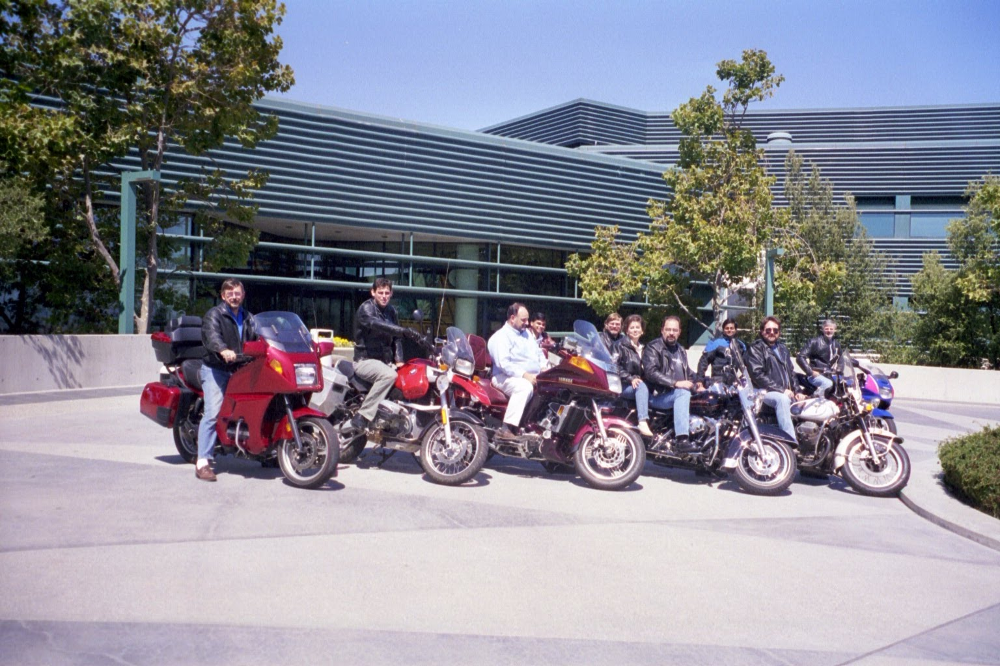

Ceph came out of the [Storage Systems Research Center (SSRC)](https://www.ssrc.us/proj/exscale.html) at UC Santa Cruz, the laboratory that [Dr. Ethan Miller](https://www.ethanmiller.org/) and I built together. I coauthored the [2006 OSDI paper on Ceph](https://www.usenix.org/legacy/event/osdi06/tech/full_papers/weil/weil.pdf) with Dr. Sage Weil, Dr. Scott Brandt, Dr. Ethan Miller, and Dr. Carlos Maltzahn.

Ethan and I helped design Ceph. His research on parallel I/O and decentralized data placement included RAID-II and RAMA at Berkeley, RUSH with R. J. Honicky at the SSRC, and CRUSH with Sage, Scott, and Carlos. My work on Swift and IBM Storage Tank contributed the use of objects and separate metadata services.

## Swift

Dr. Luis-Felipe Cabrera and I began Swift at IBM Almaden in 1989. Felipe worked at IBM; I was at UC Santa Cruz. Our first publications appeared in 1991: [“Exploiting Multiple I/O Streams to Provide High Data-Rates”](/publications/227/) at the Summer USENIX conference in June, and [“Swift: A Storage Architecture for Large Objects”](/publications/4/) at the Symposium on Mass Storage Systems in October. The full architecture appeared in [*Computing Systems*, volume 4, number 4](/publications/177/), also in 1991.

The two biggest ideas were **using objects** and **separating data from metadata**. Swift’s storage agents held data and managed their local devices. A separate storage mediator managed directory information, access rights, and object locations. The client’s distribution agent obtained a transfer plan from the mediator, then moved data directly to or from the storage agents.

Swift striped large objects across storage agents and transferred their pieces in parallel, combining the bandwidth of several disks and network connections.

Swift’s early funding came from Lawrence Livermore National Laboratory (LLNL) and the National Science Foundation (NSF). The [awards listed in my CV](/cv.pdf) were \$15,183 from LLNL for 1991–92 and \$68,955 from NSF for 1991–93. Bruce Montague, Felipe, and I later developed [Swift/RAID](/publications/176/), published in *Computing Systems* in 1994, adding distributed RAID fault tolerance.

I carried Swift’s separation of data from metadata into **IBM Storage Tank** as one of its architects. I was a [visiting scientist at IBM Almaden from 1995 to 2011](/cv.pdf). Bob Rees, David Pease, [Randal Burns](https://www.cs.jhu.edu/faculty/randal-burns/), Wayne Hineman, and I put the Storage Tank architecture together on the second floor of the B wing at IBM Almaden.

*The IBM Storage Tank team: architects, programmers, and staff.*

We put metadata and locking in separate services, as described in our [2002 Storage Tank paper](https://www.usenix.org/legacy/events/fast02/wips/pease.pdf). Clients contacted those services to coordinate access, then read and wrote data directly over the Fibre Channel storage area network (SAN).

This allowed machines running AIX, Linux, and Windows to access the same file system concurrently. Storage Tank became [IBM TotalStorage SAN File System](https://home.cern/cern-openlab-adds-a-new-dimension-to-grid-computing/).

## RAID-II and RAMA

At Berkeley, Ethan was part of the team that built [RAID-II](https://ethanmiller.org/files/pubs/isca94.pdf). The first RAID prototype’s disks could supply more data than the host workstation’s memory system could move. RAID-II used a custom crossbar memory system, the XBUS board, to connect the disks to a high-speed network, allowing large data transfers to bypass the server workstation.

Ethan and Dr. Randy Katz described RAMA, **Rapid Access to Massive Archive**, in their [1993 mass-storage paper](https://ethanmiller.org/files/pubs/mss93.pdf). Ethan developed it in his [1995 dissertation, *Storage Hierarchy Management for Scientific Computing*](https://www2.eecs.berkeley.edu/Pubs/TechRpts/1995/5206.html). RAMA treated disks as a cache for a larger store on tape or other tertiary media.

RAMA used hashing to determine placement. Given a file’s identifier and a block’s offset, a node could calculate the destination node and disk region without consulting a central directory of block locations. The destination maintained a local index to find the block within that region.

Randomized placement addressed a problem with regular striping: an application’s access pattern could repeatedly hit the same subset of disks. RAMA distributed requests without requiring applications to tailor their accesses to the disk layout. Ethan evaluated it using simulations with real and synthetic workloads.

At Santa Cruz, Ethan and R. J. Honicky developed [RUSH, Replication Under Scalable Hashing](https://www.ssrc.us/pub/honicky-ipdps04.html), published in 2004. RUSH calculated object placement across servers with different weights, put replicas on separate servers, and limited data movement as the system changed. Clients could calculate locations independently.

Sage Weil, Scott Brandt, Ethan Miller, and Carlos Maltzahn built on RUSH with [CRUSH in 2006](https://www.ssrc.us/media/pubs/9c7bcd06ff4eeccef2cb4c7813fe33ba7d4805c7.pdf). CRUSH added a hierarchy describing the storage system and placement rules that could keep replicas in different failure domains, such as separate racks. Clients could calculate placement from an object identifier, the cluster map, and those rules.

## The ASCI Proposal

We worked out the design for the proposal that led to Ceph on the board in our lab in Baskin Engineering, room 308. It drew heavily on Swift. We submitted it through the Department of Energy’s Accelerated Strategic Computing Initiative (ASCI) to the Tri-Labs: Lawrence Livermore National Laboratory (LLNL), Los Alamos National Laboratory (LANL), and Sandia National Laboratories. The proposal, [*Scalable File Systems for High Performance Computing*](/pdfs/long-trilabs-asci-proposal-2001.pdf), is dated **June 1, 2001**.

We proposed thousands of object-based storage devices, which we called OBSDs, connected by high-speed networks. Each device would manage its own block allocation, free space, and local consistency. Requests would identify a file and a range of bytes; the device would decide where to store them. Devices could transfer data in parallel and check their own consistency, avoiding a serial check of the entire file system.

Metadata had its own cluster of servers to translate names into file identifiers and manage file attributes and high-level placement information. Section 2.2.1 explains: “storing it on a metadata server cluster separates data from metadata, allowing OBSD and metadata servers to be scaled independently.” Clients would contact the metadata service when opening or closing a file, then transfer data directly to the storage devices. The [architecture diagram on page 4](/pdfs/long-trilabs-asci-proposal-2001.pdf#page=4) shows the metadata cluster, storage devices, supercomputers, visualization systems, and remote clients sharing a network.

We were designing for the laboratories’ post-Purple requirements: two petabytes of data, with sustained transfer rates of 100 GB/s to 1 TB/s. The system had to serve large simulations, interactive visualization, and workstations accessing small files through a POSIX interface. We proposed a prototype built from commodity components, with two metadata servers and eight storage devices, followed by scalability tests on larger installations at the laboratories.

The [division of work in Section 2.4](/pdfs/long-trilabs-asci-proposal-2001.pdf#page=8) assigned me the metadata-server software, workload characterization, and coordination with the Tri-Labs. Ethan was to lead the storage-device software, and Scott the client file-system software. Patrick Mantey, Alexandre Brandwajn, and Katia Obraczka were also named in the proposal. We had hoped they would participate, but they had other priorities and did not work on the project. The proposal also identified me as one of the architects of IBM Storage Tank.

Our friends Gary Grider at LANL, Steve Louis at LLNL, and Lee Ward at Sandia helped us obtain the funding. Steve was our primary technical contact. We planned to incorporate our existing ASCI Level 3 collaboration on object-based storage into the project.

The [awards listed in my CV](/cv.pdf#page=5) were **\$65,000 from LLNL for 2001–02** to build high-performance storage from commodity components, followed by **\$900,000 from the DOE Defense Programs Laboratories for 2002–05** for *Scalable File Systems for High Performance Computing*. The same project received another **\$250,000 for 2005–06**. The proposal was written in 2001; the larger Tri-Labs award covered 2002–05.

Funding from the Department of Energy’s National Nuclear Security Administration (NNSA) did not make me popular in certain quarters of campus. I have written about that hostility in [*The War Criminals who invented Sensor Networks*](/blog/2026-10-28-a-proud-war-criminal/).

## Dr. Weil’s Research

Dr. Weil did brilliant research for his December 2007 dissertation, [*Ceph: Reliable, Scalable, and High-Performance Distributed Storage*](https://ceph.io/assets/pdfs/weil-thesis.pdf). His contributions included adaptive distributed metadata management, the CRUSH placement algorithm, and a distributed object store that maintained consistent data as devices failed and the cluster changed.

Dividing the directory tree among servers could preserve locality, but a fixed division could leave one server overloaded while others sat idle. Sage’s dynamic subtree partitioning moved responsibility for parts of the directory tree as the workload changed. The [2004 paper with Kristal Pollack, Scott Brandt, and Ethan Miller](https://www.ssrc.us/pub/weil-sc04.html) compared that approach with static partitioning and hashing through simulation, examining performance, scaling, and adaptation to changing workloads.

Sage’s metadata design embedded file metadata within directory objects, used journals to combine repeated updates, and divided large or busy directories into fragments that could be managed separately. He also developed recovery protocols for failed metadata servers.

For [CRUSH](https://www.ssrc.us/media/pubs/9c7bcd06ff4eeccef2cb4c7813fe33ba7d4805c7.pdf), Sage evaluated the tradeoffs among balanced placement, fast calculation, limited data movement when the cluster changed, and protection against failures affecting multiple devices. He compared structures used to select devices within the hierarchy.

Sage, Andrew Leung, Scott Brandt, and Carlos Maltzahn described [RADOS, the Reliable Autonomic Distributed Object Store](https://ceph.io/assets/pdfs/weil-rados-pdsw07.pdf), in a 2007 paper. It maintained consistent reads and writes through device failures and changes in cluster membership. Storage devices shared responsibility for replication, failure detection, and recovery. Versioned cluster maps let clients and devices identify which view of the system an operation used, while a small monitor cluster maintained agreement on the authoritative map. Placement groups organized objects whose replicas were managed together.

Sage evaluated these designs in a working Ceph prototype, measuring metadata throughput, data distribution, I/O performance, and recovery.

Lan Xue worked with us on the earlier Lazy Hybrid approach to metadata management. Feng Wang developed OBFS, a file system for object-storage devices. Qin Xin studied reliability and distributed recovery, including how using available capacity and bandwidth across many disks could shorten recovery after a failure.

Feng Wang, Qin Xin, and Bo Hong also worked with us and Tyce McLarty to characterize scientific I/O workloads. Their traces showed bursty access and large transfers; their experiments measured the performance costs of file sharing. The [March 2006 Ceph technical report](/publications/52/) includes Feng and Qin among its authors.

## Full Circle

After his doctorate, Sage continued Ceph’s development with a team at DreamHost and cofounded Inktank to develop and support it commercially. [Red Hat acquired Inktank in 2014](https://ceph.io/en/news/blog/2014/red-hat-to-acquire-inktank/). [IBM completed its acquisition of Red Hat in 2019](https://www.ibm.com/investor/news/ibm-completes-acquisition-of-red-hat).

Swift had begun at IBM and helped shape both Storage Tank and Ceph. It all came home in the end.

## References

1. Luis-Felipe Cabrera and Darrell D. E. Long. [“Swift: Using Distributed Disk Striping to Provide High I/O Data Rates.”](/publications/177/) *Computing Systems* 4(4), 1991.

2. Ethan L. Miller and Randy H. Katz. [“RAMA: A Filesystem for Massively Parallel Computers.”](https://ethanmiller.org/files/pubs/mss93.pdf) *Twelfth IEEE Symposium on Mass Storage Systems*, 1993.

3. Ann L. Drapeau, Ken W. Shirriff, John H. Hartman, Ethan L. Miller, Srinivasan Seshan, Randy H. Katz, Ken Lutz, David A. Patterson, Edward K. Lee, Peter M. Chen, and Garth A. Gibson. [“RAID-II: A High-Bandwidth Network File Server.”](https://ethanmiller.org/files/pubs/isca94.pdf) *International Symposium on Computer Architecture (ISCA)*, 1994.

4. Darrell D. E. Long, Bruce R. Montague, and Luis-Felipe Cabrera. [“Swift/RAID: A Distributed RAID System.”](/publications/176/) *Computing Systems* 7(3), 1994.

5. D. A. Pease, R. M. Rees, W. C. Hineman, D. L. Plantenberg, R. A. Becker-Szendy, R. Ananthanarayanan, M. Sivan-Zimet, C. J. Sullivan, R. C. Burns, and D. D. E. Long. [“IBM Storage Tank: A Distributed Storage System.”](https://www.usenix.org/legacy/events/fast02/wips/pease.pdf) *Conference on File and Storage Technologies (FAST), Work-in-Progress presentation*, 2002.

6. Scott A. Brandt, Ethan L. Miller, Darrell D. E. Long, and Lan Xue. [“Efficient Metadata Management in Large Distributed Storage Systems.”](/publications/37/) *IEEE/NASA Goddard Conference on Mass Storage Systems and Technologies (MSST)*, 2003.

7. Qin Xin, Ethan L. Miller, Thomas J. E. Schwarz, Darrell D. E. Long, Scott A. Brandt, and Witold Litwin. [“Reliability Mechanisms for Very Large Storage Systems.”](/publications/38/) *MSST*, 2003.

8. R. J. Honicky and Ethan L. Miller. [“Replication Under Scalable Hashing: A Family of Algorithms for Scalable Decentralized Data Distribution.”](https://www.ssrc.us/pub/honicky-ipdps04.html) *International Parallel and Distributed Processing Symposium (IPDPS)*, 2004.

9. Feng Wang, Scott A. Brandt, Ethan L. Miller, and Darrell D. E. Long. [“OBFS: A File System for Object-Based Storage Devices.”](/publications/45/) *MSST*, 2004.

10. Feng Wang, Qin Xin, Bo Hong, Scott A. Brandt, Ethan L. Miller, Darrell D. E. Long, and Tyce T. McLarty. [“File System Workload Analysis for Large Scale Scientific Computing Applications.”](/publications/44/) *MSST*, 2004.

11. Qin Xin, Ethan L. Miller, and Thomas J. E. Schwarz. [“Evaluation of Distributed Recovery in Large-Scale Storage Systems.”](https://www.ssrc.us/pub/xin-hpdc04.html) *International Symposium on High Performance Distributed Computing (HPDC)*, 2004.

12. Sage A. Weil, Kristal T. Pollack, Scott A. Brandt, and Ethan L. Miller. [“Dynamic Metadata Management for Petabyte-Scale File Systems.”](https://www.ssrc.us/pub/weil-sc04.html) *ACM/IEEE Conference on Supercomputing (SC)*, 2004.

13. Sage A. Weil, Feng Wang, Qin Xin, Scott A. Brandt, Ethan L. Miller, Darrell D. E. Long, and Carlos Maltzahn. [“Ceph: A Scalable Object-Based Storage System.”](/publications/52/) Technical report *UCSC-SSRC-06-01*, March 2006.

14. Sage A. Weil, Scott A. Brandt, Ethan L. Miller, and Carlos Maltzahn. [“CRUSH: Controlled, Scalable, Decentralized Placement of Replicated Data.”](https://www.ssrc.us/media/pubs/9c7bcd06ff4eeccef2cb4c7813fe33ba7d4805c7.pdf) *SC*, 2006.

15. Sage A. Weil, Scott A. Brandt, Ethan L. Miller, Darrell D. E. Long, and Carlos Maltzahn. [“Ceph: A Scalable, High-Performance Distributed File System.”](https://www.usenix.org/legacy/event/osdi06/tech/full_papers/weil/weil.pdf) *Proceedings of the 7th USENIX Symposium on Operating Systems Design and Implementation* (**OSDI ’06**), pp. 307–320, November 2006.
