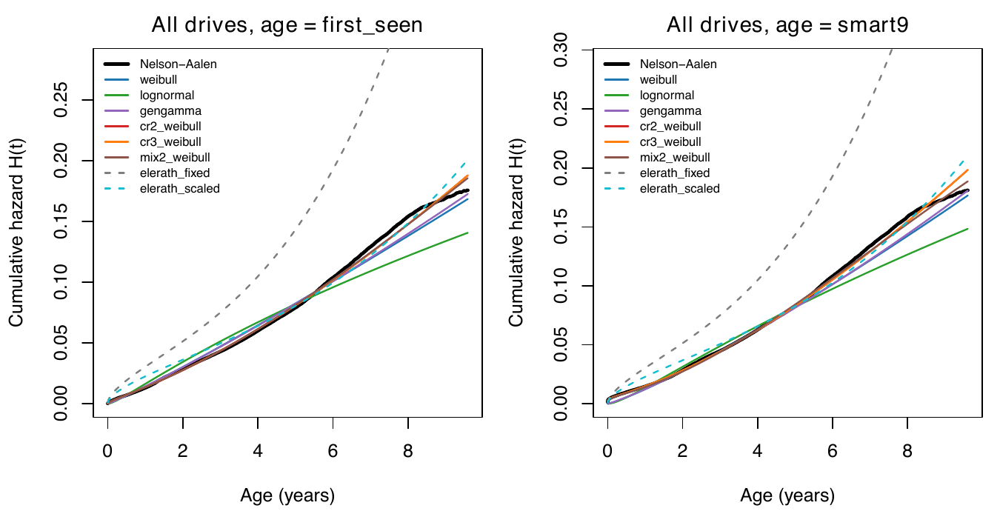
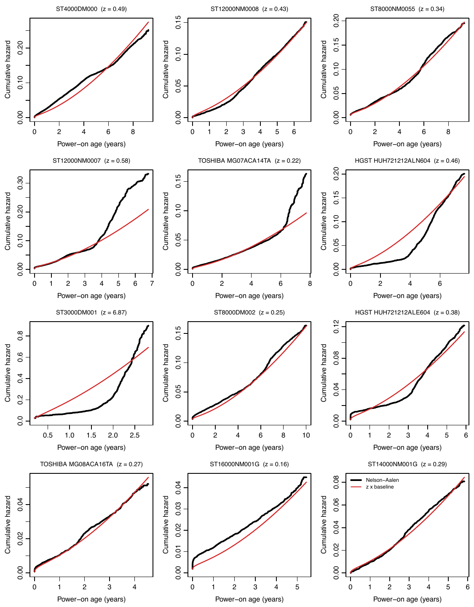

Since 2013 Backblaze has published a daily record of every drive in its data centers: the serial number, the drive model, the SMART attributes (the counters a drive keeps about its own health: reallocated sectors, hours powered on, temperature and so on), and a flag on the day the drive was recorded as failed. Through June 2026 it covers 504,624 data drives (the drives of 1.4 TB and more that hold customers' data, as opposed to boot drives) of 99 models with a usable power-on age, two million drive-years of observation (one drive-year is one drive observed for one year), and 31,881 recorded failures. I know of nothing else of this size and detail that is public.

Dr. Ahmed Amer and I have spent the past months fitting lifetime distributions to these data, evaluating their predictions on subsequent years excluded from training, and implementing random lifetime generators for storage simulators. The report is still under review. This post reflects its November 1, 2026 revision, including the revised drive-model estimates and annual count comparisons. The calendar-time, per-drive forecasting and RAID comparisons still use earlier fits, identified below.

The count of 99 drive models follows standardization of whitespace and the merging of three pairs of names for the same part. We also classify the WUH Ultrastar drives with the HGST product line, although they are sold under Western Digital's name. These corrections matter when a drive-model name or manufacturer determines which parameters a program uses.

## Decide What a Failure Is

A failure flag records an operational decision: Backblaze removed and replaced the drive because it stopped working or, in their words, had "shown evidence of failing soon." The data do not distinguish these two reasons for replacement. The failure rates in our report therefore include proactive replacements under Backblaze's policy. This distinction matters especially when evaluating SMART warnings, because the same warnings used to predict failures can cause an operator to replace a drive and record a failure.

Drives also leave without a failure flag. For every drive that fails, nearly four are removed: 120,377 against 31,899. Almost all of the removals are migrations, in which an operator retires a group of drives at once: 116,928 drives in 789 events in which twenty or more drives of one model left on the same day. The largest removed 2,107 drives in a day at a median age of 8.6 years. Our models treat these departures as censored observations: each drive is known to have survived until removal, with its subsequent lifetime unknown. We assume removal is independent of the drive's failure risk. That assumption is violated if drives are removed because they are about to fail, and the data provide no removal reasons. A drive with a SMART warning is removed individually at 5.8 times the rate of a drive without a warning, but it is 22 times as likely to receive a failure flag as to be removed individually without one.

We therefore refit the lifetime distribution under several assumptions about removals. Counting individual removals of warned drives as failures lowers the fitted ten-year survival probability of the average drive model from 0.81 to 0.80. Also counting the 42 bulk events in which removed drives had warnings far more often than retained drives lowers it to 0.77. Assuming every warned drive removed was about to fail lowers it to 0.63. These differences measure how sensitive the survival estimates are to the treatment of removals.

The failure flag has another complication. 1,026 failed data drives appear in the daily files again after their final failure flag, some for years. Across the whole corpus, 57 drives have multiple flagged rows; 44 data drives with a usable age have two flags. We do not know whether the later records indicate recovery from a transient fault, reuse after testing, or a recording error. We treat failure as a terminal state, dated by the final flag, and exclude subsequent records under that serial number from exposure, the drive-days during which a failure could have been recorded. Treating the later records as a second period of service changes the fitted ten-year survival by 0.01 percentage points and, among the drive models with at least a hundred failures, the per-model failure-rate multipliers introduced below by at most 4.6 percent. Dropping those drives would discard 3.2 percent of the failures, a third of them from the ST3000DM001, the worst drive model in the fleet, whose history is told below.

## Age Is Power-On Age, and Many Drives Arrive Old

Time since a drive's first appearance in the record can underestimate its age. Fifteen percent of drives were more than thirty days old when first observed, and among the data drives 2.8 percent were more than a year old. A drive first observed at age two that fails at age three has failed after three years of service, despite appearing in the data for only one year.

SMART attribute 9 counts power-on hours. For each drive we take the reading on its first observed day of each month. A reading of $s$ hours, taken $\Delta$ days after the drive was first observed, gives an estimate of its age at entry,

$$
a^{(0)} = \frac{s}{24} - \Delta \ \text{days},
$$

and we use the estimate from the earliest month with a reading. Later readings can be unreliable: on 21,404 drives a later estimate disagrees with the first by more than 45 days and ten percent of the elapsed time. The largest group consists of Seagate 6 and 8 TB models whose counters wrap around after about 78,200 hours, or 3,258 days. Requiring agreement between early and late readings would discard the longest-lived drives in the fleet.

A drive that enters observation at age $a_0$ and leaves at age $a_1$, failing or not, contributes one interval to the likelihood, the probability of the observed record under the distribution being fitted. The interval is left-truncated, because the drive was not observed before $a_0$, and right-censored if the drive left without failing. With $S(a)$ the probability of surviving to age $a$ and failures known to the day,

$$
\ell = \sum_i \Bigl[\delta_i \log\bigl(S(a_{1i}-1) - S(a_{1i})\bigr) + (1-\delta_i)\log S(a_{1i}) - \log S(a_{0i})\Bigr],
$$

where $\delta_i$ is one for a failure. The last term is the left truncation: the drive could only be observed because it survived to $a_0$. Because ages are whole days, the likelihood depends on the data only through counts at each age, and a fit over half a million drives costs a few thousand evaluations of $S$.

The interval likelihood above uses calendar spans. For the count models, we count exposure only on days when a drive appears in the files. Some drives are absent for weeks and then reappear. For the data drives with a usable age, the intervals from first observation to failure or removal total 739 million days, but the files contain only 732 million observed drive-days. During an unobserved interval, no failure flag could have been recorded, so we exclude those days from the count models' exposure.

## A Pooled Fleet Is a Mixture

This descriptive comparison uses the whole fleet through 2025, including about 8,000 small and solid-state boot drives. The drive-model fits and held-out count comparisons below use only the HDD data drives through June 2026.

The hazard $h(a)$ is the failure rate at age $a$ among the drives that have survived to that age, and the cumulative hazard $H(a) = \int_0^a h(u)\,du$ determines survival through $S(a) = e^{-H(a)}$. The figure compares several fitted distributions with the Nelson–Aalen estimate of the fleet's cumulative hazard, which does not assume a particular lifetime distribution: $\hat H(t) = \sum_{u\le t} d_u/Y_u$, with $d_u$ the failures at age $u$ and $Y_u$ the drives at risk at that age. On the right, age is power-on age. The hazard falls through the first months and rises after about four years. A Weibull distribution has cumulative hazard $(a/\eta)^\beta$. The exponent $\beta$ determines how the failure rate changes with age: it decreases for $\beta < 1$, is constant for $\beta = 1$, and increases for $\beta > 1$. The scale parameter $\eta$ is the age at which the cumulative hazard reaches one. A model with two independent failure mechanisms, each with a Weibull lifetime distribution, fits the fleet about as well as the other distributions we tested:

$$
H_0(a) = \Bigl(\frac{a}{\eta_1}\Bigr)^{\beta_1} + \Bigl(\frac{a}{\eta_2}\Bigr)^{\beta_2},
$$

A drive fails when either mechanism fails, so their hazards add. Fitted to the pooled fleet, the exponents are $\beta_1 = 0.23$ and $\beta_2 = 1.46$, with a wear-out scale parameter $\eta_2$ of 30.6 years. The early-life scale parameter $\eta_1$ is approximately $1.3\times10^{9}$ years. With exponent $\beta_1 = 0.23$, that component's cumulative hazard grows in proportion to $a^{0.23}$, while its failure rate decreases in proportion to $a^{-0.77}$. The large value of $\eta_1$ makes this component's cumulative hazard small over the observed ages. Neither component's scale parameter is the drive's expected lifetime.

The dashed gray curve is the fixed three-component Weibull model that storage simulators, including ones I have worked on, have used for twenty years. Its exponents are 0.5, 1 and 3, with corresponding scale parameters of $2.2\times10^7$, $8.77\times10^5$ and $1.2\times10^5$ hours. The three components represent early failures, a constant background failure rate, and wear-out, producing the familiar bathtub failure-rate curve. On this fleet it predicts 2.4 times the failures observed and scores worse than a constant-rate model. Its parameters describe drives of the mid-2010s tolerably and current drives poorly. Fitted parameters should be reported with the dates of the data used to estimate them.

Proschan showed in 1963, using aircraft air conditioners, that a population of units with different constant failure rates can have a decreasing aggregate failure rate. Units with higher failure rates fail sooner, leaving a larger proportion of more reliable units among the survivors. This accounts for part of the early decline in the fleet's failure rate: the fleet contains a hundred drive models with very different rates, and their relative proportions change as drives fail.

## The Drive Model Matters More Than the Lifetime Distribution

We fit to the data through each December and evaluate predictions for the following year, for nine successive years. We group failure counts by drive model, month and age bin. The point-forecast score is the sum of the Poisson log probabilities assigned to the observed counts; a higher score indicates better predictions. Adding drive-model failure-rate multipliers with means determined by the model's attributes improves the two-Weibull distribution's score by 2,569 log units. With the same treatment of drive model, replacing a single Weibull with two competing Weibulls gains 603 units; replacing a constant failure rate gains 776. Among drive models with at least 500 drive-years, the fitted multipliers range from 0.072 to 6.9, a factor of about 95. Accounting for the drive model improves predictions much more than changing the lifetime distribution.

These count comparisons use the exposure actually observed in the test year, including drives installed during that year and the dates when others failed or left. They evaluate failure rates given that exposure. The prospective forecasts in the SMART section instead predict failures among drives present on a specified date, using information available then.

We represent differences between drive models with a gamma-distributed failure-rate multiplier, a method known as gamma frailty in survival analysis. We write $\mathrm{Gamma}(\alpha,\lambda)$ for the gamma distribution with dimensionless parameter $\alpha$ and rate parameter $\lambda$; its mean is $\alpha/\lambda$ and its variance is $\alpha/\lambda^2$. For a drive of model $g$ at age $a$,

$$
h(a \mid g) = Z_g\, h_0(a), \qquad Z_g \sim \mathrm{Gamma}\Bigl(\frac{1}{\phi},\ \frac{1}{\phi\mu_g}\Bigr),
$$

so that $\mathbb{E}[Z_g] = \mu_g$ and the coefficient of variation of $Z_g$, its standard deviation divided by its mean, is $\sqrt{\phi}$. This prior distribution describes uncertainty about a drive model's multiplier before using its observed failures. Its mean depends on the model's known attributes: $\log\mu_g$ is linear in the model's introduction year (the fractional year it first appears in the record), the logarithm of its capacity, and indicator variables for its manufacturer and helium status. Combining this gamma prior with the Poisson approximation for daily failures gives a gamma posterior, so the update has a closed-form solution. Let $D_g$ be the number of failures and $M_g$ the total baseline cumulative hazard over the observation intervals. At a recorded failure, we use the average cumulative hazard at the start and end of that day for the interval's endpoint. Then

$$
Z_g \mid \text{data} \sim \mathrm{Gamma}\Bigl(\frac{1}{\phi} + D_g,\ \frac{1}{\phi\mu_g} + M_g\Bigr).
$$

For a drive model with many failures, the observations dominate the estimated multiplier. For a model with few failures, the estimate remains closer to the prior mean determined by introduction year, capacity, manufacturer and helium status. The per-model parameters fit in a small table with one row per drive model. For a drive model with no history, a simulator samples the multiplier from the prior. The fitted baseline, for the reference drive model (an air-filled 8 TB Seagate introduced in 2018, $\mu_g = 1$), has exponents $\beta_1 = 0.28$ and $\beta_2 = 1.57$ and wear-out scale parameter $\eta_2 = 14.0$ years. A drive model with multiplier $z$ has the effective wear-out scale parameter $\eta_2 z^{-1/\beta_2}$, 74.5 years at $z = 0.0724$ and 4.1 years at $z = 6.87$.

Helium is a new predictor in this fit. We classify 43 of the 99 drive models as helium-filled, accounting for 66 percent of exposure, using the SMART attributes they report and model-name rules where those measurements are unavailable. Nearly all helium models have capacities of at least 10 TB, so the effects of helium and capacity are difficult to separate. The fitted helium coefficient is 0.464 with a standard error of 0.462. These data do not establish an independent helium effect.

The figure shows the twelve drive models with the most failures, each with its Nelson–Aalen estimate in black and $z_g H_0(a)$ in red, using the revised fit with helium. Multiplying the baseline cumulative hazard by a constant fits about half of them. It does not fit the ST3000DM001, whose hazard rose steeply after about two years, nor the HGST HUH721212ALN604, which had almost no failures for four years and then failed at a rate that increased faster than the baseline predicts. A common age-dependent failure rate with a multiplier for each drive model accounts for much of the observed variation, but some drive models have systematic deviations from that estimate.

Giving each drive model its own wear-out exponent has not produced a reliable improvement. The revised empirical-Bayes fits all reach their stopping rule, yet the 2019 forecast is 4,471,820 failures against 2,048 observed. Almost all of that prediction comes from Toshiba MG07ACA14TA: eight training failures lead to a fitted exponent of 11.99 and a forecast of 4,470,180 failures, against nine observed. Even excluding 2019, this model scores 531 log units below the common-exponent model over the other eight years, with a standard error of 794. Terminating the fitting iteration does not establish that extrapolation works.

The recent Bayesian checks expose a separate mathematical problem. Three variants assign a lognormal distribution to each drive model's wear-out exponent. For a drive model unseen in training, or observed only in age bins ending at or before four years, the predicted failure count has an infinite mean in an exposed bin extending beyond four years. Four years is the reference age in these models. The possible exponents have an unbounded upper tail, and the resulting failure rates grow too quickly for the expectation to converge. The condition occurs in every one of the nine test years, so the expected fleet total is infinite in all nine. A finite average of simulated counts does not estimate a finite posterior mean, even though the predictive probabilities are well defined.

There are numerical problems as well: some posterior samples fail to explore the full distribution, and the calculated predictive scores change when the integration grid is refined or its range extended. One variant's earlier score calculation also used age cutoffs different from those required by its forecast. The corrected calculations are still being checked. The reported score gains do not establish that these per-model wear-out variants are suitable for lifetime simulation.

The ST3000DM001 is the best-known case. Backblaze bought 4,829 of them during the drive shortage that followed the 2011 Thailand floods and described what happened in 2015: 2.7 percent failed in 2012, 5.4 percent in 2013 and 47.2 percent in 2014. Storage pods, Backblaze's chassis of 45 drives, lost additional drives during rebuilds while reconstructing a failed drive's contents onto its replacement. Our record has 4,707 of them with 1,708 failures, 36 percent of the drives. In 2014 their annualized failure rate, failures per drive-year, was 43 percent and they accounted for about 60 percent of the fleet's failures. A single Weibull fitted to them alone has exponent $\beta = 4.04$ and scale parameter $\eta = 2.9$ years, indicating one of the steepest increases in failure rate with age in the fleet. All were deployed before the record begins in April 2013, so accounting for their age at entry is particularly important.

The record has no lot numbers, so it cannot identify a production run. These drives were deployed over about a year, from February 2012 to January 2013, allowing comparisons at similar ages in different calendar periods and at different ages in the same period. Among drives one to two years old, failures ran at 6 per hundred drive-years in the second quarter of 2013, 24 in the fourth, 61 in the third quarter of 2014, and 28 in the first quarter of 2015: a tenfold difference across calendar periods within the same age range. Within the third quarter of 2014, drives one to two years old failed at 61 per hundred drive-years and drives two to three years old at 178: a threefold difference by age within the same period. The failure rate peaked in the summer of 2014, especially among older drives, and age alone does not explain the increase. Of the drives that reappear in the files after a failure flag, a third are this model, which is consistent with Backblaze's account of removing, bench-testing and reusing them. The next section introduces a separate annual failure-rate multiplier for each drive model to represent this kind of variation. The simulation section examines the consequences of correlated failures within an array.

Forecasts for drive models with no history expose another limitation. In the earlier fit without helium, using the prior mean of the failure-rate multiplier predicted 728 failures over the nine test years against 126 observed. Two Seagate models in 2020 accounted for 499 of the predicted failures, against 43 observed. For drive models with no history, integrating predictions over the prior distribution of the multiplier gave the observed counts a higher log probability than using any of the point estimates we tested. This breakdown has not yet been replaced by the revised fit.

## Calendar Time Is a Variable

The calendar-time results here come from the earlier Bayesian fits without helium. After accounting for age and drive model, the fleet's failure rate still varies by calendar year. The estimated fleet-wide multiplier in 2026 is 0.174 of its 2013 value. We represent calendar time with two failure-rate multipliers. The fleet-wide annual multiplier $Q_y$ follows a random walk with drift: its logarithm in each year equals the previous year's value plus a fixed increment and a random increment. A second multiplier, $U_{gy}$, applies to drive model $g$ in calendar year $y$. It has mean one and is sampled independently for each combination of drive model and year. The hazard is

$$
h(a \mid g, y) = Q_y\, U_{gy}\, Z_g\, h_0(a).
$$

The multiplier $U_{gy}$ represents annual variation specific to a drive model that its age-dependent failure rate, its persistent multiplier $Z_g$, and the fleet-wide multiplier $Q_y$ do not explain. Possible causes include a firmware fault, a bad production run, high operating temperatures, or a change in replacement policy. The records cannot distinguish these causes. We estimate the variability of $U_{gy}$ from the data as a function of the expected annual failure count. Its coefficient of variation is 0.97 for a drive model expected to have one failure in the year and 0.27 for one expected to have a thousand.

These annual multipliers improve prediction-interval coverage. On a prespecified set of 169 combinations of drive model and year with substantial failure history in training, the model without the multipliers $U_{gy}$ produced 95 percent prediction intervals that contained the observed failure count only 43 percent of the time. With $U_{gy}$ and the time-varying fleet multiplier $Q_y$, coverage increased to 93 percent, much closer to the nominal 95 percent. The observed counts have much greater variance than a Poisson distribution with the same mean. Accurate mean predictions alone are insufficient for estimating risk.

Aggregating the records substantially reduces computation. If the hazard is constant within each age and calendar-period bin, the survival likelihood is equivalent, up to a parameter-independent factor, to a Poisson likelihood for the failure counts with means proportional to exposure. Holford showed this in 1980. A table of failure counts and drive-days by age and calendar period is called a Lexis table after the demographer Wilhelm Lexis. We fit the Bayesian models to one such table, indexed by drive model, calendar year and age bin, instead of processing half a million individual drive histories for each fit.

## Age, Period and Cohort Cannot Be Separated

A drive first observed at calendar time $t_0$ at age $a_0$ has age $a(t) = a_0 + t - t_0$ at time $t$. Age, calendar time and the service start date are linearly dependent, so their linear trends cannot be estimated separately without additional constraints. Holford discussed this identification problem for mortality rates in 1983 and Clayton and Schifflers in 1987. Variation in service start dates permits comparisons such as those for the ST3000DM001, but it does not remove the linear dependence. That variation is also limited: the interquartile range of service start dates is 0.34 years for the median drive model, and between 0.2 and 1.6 years across models with at least 10,000 drives.

Two models with similar forecasts one to three years ahead can therefore give substantially different long-term predictions. In the earlier Bayesian fits, the wear-out exponent without an annual fleet multiplier is $\beta_2 = 1.57$. Including a declining annual multiplier increases the fitted exponent to 1.94: a faster increase in failure rate with age is offset by a decrease over calendar time. The two models' predicted fifteen-year survival probabilities for the same drive models differ by up to 0.18. Alternative assumptions about whether the decline over calendar time continues produce differences of up to 0.27. Only two percent of the exposure is beyond eight years of age. Above ten years there are just 147 drive-years and no recorded failures, providing little information about failure rates at those ages. Simulations of a drive's second decade depend on extrapolation assumptions that must be stated explicitly.

## SMART Warnings Work, Within Limits

Backblaze monitors five SMART attributes: 5 (reallocated sectors), 187 (reported uncorrectable errors), 188 (command timeouts), 197 (pending sectors) and 198 (offline uncorrectable sectors). We classify a drive as warned once any of these attributes has a nonzero value. A drive without a recorded warning may have unreported attributes; missing values do not establish that the counters were zero. Over the full record, the annualized failure rate is 0.40 percent for drives without a warning and 16.3 percent for warned drives, a fortyfold difference. Warned drives account for 7.4 percent of exposure and 76 percent of failures. Backblaze reported that 76.7 percent of failed drives had a warning in its 2016 analysis; over thirteen years we find 76.2 percent.

Three factors limit the predictive value of these warnings. First, the forty-fold ratio partly reflects replacement policy. Backblaze uses these same attributes to identify failing drives, and a proactive replacement with a failure flag counts as a failure in the data. Second, the warning often arrives late: 850 of the warnings came on the day of failure, and of the failures in a calendar year, only 39 percent were on drives already warned on 1 January. The other 61 percent were on drives without a warning when the forecast was made. Third, manufacturers report different attributes. Attributes 187 and 188 are reported almost exclusively by Seagate drives, so a comparison across manufacturers based on "any of the five" partly measures differences in reporting.

Failure rates also depend on time since the warning. The annualized rate is 86 percent during the first thirty days after a warning and 5.7 percent among drives that remain in service two years after a warning. These are rates among the surviving drives at each point; they do not establish that an individual drive's risk decreases, because drives that fail quickly leave the observed population. We fitted a state-transition model with two operating states, no warning and warned, and two terminal states, failed and removed. Transition rates depend on age, calendar year, drive model and time since the warning. At a one-year horizon it predicts failures among drives in service more accurately than a model using a fixed warning multiplier, by a margin about equal to its standard error. Its predictions are less accurate than those from gradient-boosted trees using the full SMART record.

In the existing per-drive forecasting comparison, adding a SMART warning to the empirical-Bayes forecast increases the one-year area under the ROC curve (AUC) from 0.643 to 0.735. AUC measures how often a drive that subsequently fails is ranked above one that survives. Gradient-boosted decision trees using the full monthly SMART record reach an AUC of 0.744 at one year and 0.83 at ninety days. They also achieve the best per-drive log probability among the models we tested, but overestimate total failures by about twenty percent at one year. Ranking individual drives by failure risk and estimating the total number of failures require different evaluations.

## What a Simulator Should Assume

For twenty years I have estimated the durability of erasure-coded storage by sampling drive lifetimes and counting cases in which failures exceed the code's redundancy before repairs complete. Those simulations used the fixed three-component Weibull distribution described above. We repeated the simulations with the fitted distributions to measure how much the estimated loss probabilities changed.

We implemented random lifetime generators for the main fitted models in R and in a C++ library with the parameters compiled in, and checked the generated samples against the corresponding distributions. The C++ implementations take 12 to 128 nanoseconds for conditional draws with closed-form solutions. For three distributions without such a solution, tabulated inverses reduce the cost from 0.8–5.3 microseconds by bisection to 30–56 nanoseconds. A separate Rust benchmark on an NVIDIA GB10 takes about 154 nanoseconds per drive-year when it samples new annual multipliers for each drive. An array simulation that shares those multipliers can sample them once per group and year. These measurements depend on implementation and hardware, but show that the fitted distributions can be sampled cheaply enough for large simulations.

The RAID comparison uses the earlier parameter tables, before the drive-model names were merged and helium was added. We used the same simulator to evaluate RAID 5, which tolerates one failed drive; RAID 6, which tolerates two; and a 17+3 code, with seventeen data blocks and three parity blocks, which tolerates three. Each run covered ten years of service, with up to a hundred million simulated arrays per combination of code and lifetime distribution. Three choices strongly affect the estimated loss probability:

1. **Lifetime distribution.** Choosing among the fitted fleet-wide distributions changes the ten-year loss probability by about a factor of two for RAID 5 and about twelve for the 17+3 code. The configuration with the fewest observed losses has six in a hundred million trials, leaving its estimated probability uncertain by about a factor of two. The fixed three-component Weibull distribution gives six to thirty-three times the loss probability of the fitted two-Weibull distribution.
2. **Drive model.** The ten-year loss probability varies by four orders of magnitude among the six drive models we simulated, chosen to span the fitted failure-rate multipliers.
3. **Correlation among drives in an array.** Holding the other assumptions fixed, we let drives share the same sequence of fleet-wide annual multipliers $Q_y$ and the same annual multiplier $U_{gy}$ for their drive model. When the variability of $U_{gy}$ is set to the value fitted for a group expected to have ten failures a year, the RAID 6 loss probability increases by a factor of 11.9 to 15.6. Using the larger variability fitted for a group with as few expected failures as the array itself increases the loss probability by a factor of 52.7 to 89.0. Sharing only a sampled drive-model multiplier $Z_g$ changes the loss probability little; also sharing the sequence of fleet-wide multipliers $Q_y$ increases it by a factor of five to seven.

The correlation assumption remains poorly determined by these data. We can estimate the variability of annual failure-rate multipliers for a drive model across a data center, but cannot determine how much of that variation is shared by ten drives in one chassis. Backblaze's ST3000DM001 pods in 2014 illustrate the consequences of additional failures during a rebuild. A simulator must specify how strongly failure rates are correlated within an array. The two assumptions about the variability of the shared annual multiplier above produce loss probabilities differing by a factor of two to six.

## Reading the Scores

Our comparisons sum log probabilities over nine held-out years. We estimate the uncertainty of each score difference from the nine annual differences, so the unit of replication is the year. Replacing a single-Weibull baseline with two competing Weibulls improved the point-forecast score by 603 log units, with a higher score in six of nine years. Its estimated standard error was 447, computed as the standard deviation of the nine annual differences times $\sqrt{9}$. The improvement is only 1.3 times that error. Adding drive-model multipliers improved the score by 2,569 units, with a standard error of 660 and a higher score in eight of nine years. Every comparison in the report therefore includes the number of years with a higher score and the estimated standard error. The comparisons also have two limitations: training sets overlap because later fits include earlier test years, and model development used the same nine years on which we report the scores.

Numerical error is a separate issue. Agreement between repeated score estimates does not establish accuracy when the runs use the same integration approximation or fail to explore the same part of a posterior distribution. The recent checks of the per-model wear-out variants show why both sources of error need to be examined before interpreting a small score difference.

The report, with the data tables, the fitted models and the sampler library, will appear when the review is finished.

## References

- Backblaze. *Hard Drive Data and Stats.* [backblaze.com/cloud-storage/resources/hard-drive-test-data](https://www.backblaze.com/cloud-storage/resources/hard-drive-test-data).
- Backblaze. "[CSI: Backblaze — Dissecting 3TB Drive Failure](https://www.backblaze.com/blog/3tb-hard-drive-failure/)." Backblaze blog, 15 April 2015.
- Backblaze. "[What SMART Stats Tell Us About Hard Drives](https://www.backblaze.com/blog/what-smart-stats-indicate-hard-drive-failures/)." Backblaze blog, 6 October 2016.
- Frank Proschan. "Theoretical Explanation of Observed Decreasing Failure Rate." *Technometrics*, 5(3):375–383, 1963.
- James W. Vaupel, Kenneth G. Manton, and Eric Stallard. "The Impact of Heterogeneity in Individual Frailty on the Dynamics of Mortality." *Demography*, 16(3):439–454, 1979.
- Theodore R. Holford. "The Analysis of Rates and of Survivorship Using Log-Linear Models." *Biometrics*, 36(2):299–305, 1980.
- Theodore R. Holford. "The Estimation of Age, Period and Cohort Effects for Vital Rates." *Biometrics*, 39(2):311–324, 1983.
- D. Clayton and E. Schifflers. "Models for Temporal Variation in Cancer Rates. II: Age–Period–Cohort Models." *Statistics in Medicine*, 6(4):469–481, 1987.
