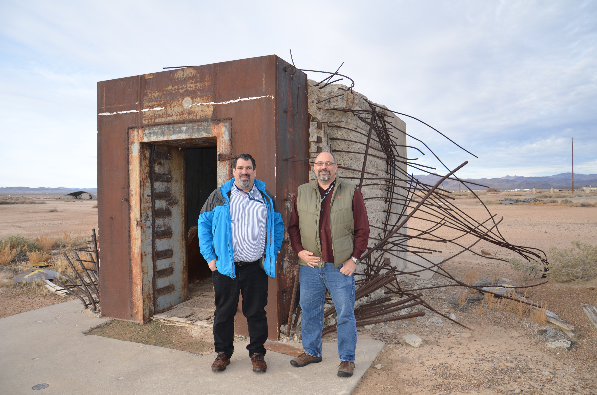

*With Dr. Ethan Miller beside the bank vault used in nuclear weapons effects testing at Frenchman Flat, Nevada Test Site.*

In winter 2018, I taught a seminar at UC Santa Cruz called *Dangerous World*, CMPE 194F. Undergraduate and graduate students studied real-world existential risks to human civilization, along with threats to the infrastructure on which it depends. The course was factual: the physics, biology, chemistry, and computer systems involved, what could go wrong, and what the consequences would be. There was no political agenda.

I had been to Nuclear Weapons School. I could talk to the students at an unclassified level about the realities of nuclear weapons, the risks of proliferation, and the effects of their use. I also drew on my work with the national laboratories and JASON, conversations with people in the field, and my readings and other studies.

The nuclear physics primer that Daniel Bittman and I prepared began with the nucleus, isotopes, and units of measurement. We worked through mass defect and binding energy: why a bound nucleus has less mass than its separate constituents, and how that difference relates to energy. We covered fission and fusion, neutron interactions, and chain reactions. The students needed enough physics to understand where the energy comes from and why nuclear reactions release so much of it.

We also distinguished energy from power, and alpha, beta, gamma, and neutron radiation from one another. The primer covered radioactive decay, half-life, and radiation dose. Those distinctions matter when discussing the effects of a weapon. Blast, heat, prompt radiation, and radioactive fallout produce different kinds of damage. The bank vault in the photograph above, where Ethan Miller and I are standing at Frenchman Flat, was part of nuclear weapons effects testing at the Nevada Test Site.

One of the main things keeping terrorists from having nuclear weapons is that [special nuclear material](https://www.nrc.gov/facilities-safety/types-of-nuclear-materials/special-nuclear-material), or SNM, is hard to obtain. The relevant fissile isotopes include uranium-235, plutonium-239, and plutonium-241. Access to suitable material is a substantial barrier to proliferation.

We examined actual national programs. Presentations covered China's nuclear development and Israel's nuclear program, and a student essay traced India's program. We discussed the Democratic People's Republic of Korea and South Africa, the only country to have developed its own nuclear arsenal and then voluntarily dismantled it. F. W. de Klerk [disclosed the South African program and its dismantlement in March 1993](https://fwdeklerk.org/speech-by-president-fw-de-klerk-to-parliament-on-the-dismantling-of-south-africas-nulcear-weapons-24-march-1993/). Another student project examined stockpile stewardship and the use of computation and experiments to assess nuclear weapons without explosive nuclear testing.

For biological weapons, I could draw on conversations with Dr. Ken Alibek, born Kanatzhan Baizakovich Alibekov, a former senior official in the Soviet biological weapons program, Biopreparat. I discussed with the students what I had learned from him, along with my readings and other studies. The materials I collected for the course included the National Academies' *Biological Threats and Terrorism: Assessing the Science and Response Capabilities* and *Countering Bioterrorism: The Role of Science and Technology*.

The United States ended its offensive biological weapons program in 1969. [President Nixon restricted subsequent biological research to defensive purposes](https://history.state.gov/historicaldocuments/frus1969-76ve02/d166), including immunization and protection. The Soviet Union kept going. Alibek helped expose the scale of that program; in his [1998 congressional testimony](https://irp.fas.org/congress/1998_hr/alibek.htm), he described its expansion after the Soviet Union joined the Biological Weapons Convention. In our conversations, he also told me about a smallpox release in the Soviet Union that he said had killed thousands of people. I brought those accounts into the class.

The history went back to medieval siege warfare: diseased bodies and rotting animal carcasses used against an enemy, including accounts of [corpses thrown over walls and carcasses used to foul water supplies](https://pmc.ncbi.nlm.nih.gov/articles/PMC88979/). A student essay examined Japan's Unit 731 and its biological and chemical warfare program.

Another student examined CRISPR-Cas9. We discussed the risk that tools of this kind, combined with knowledge of human genetic variation, could be used to develop biological weapons aimed at people with particular genetic characteristics. The prospect of targeting populations on that basis is frightening. A [National Academies report published later in 2018, *Biodefense in the Age of Synthetic Biology*](https://www.nationalacademies.org/read/24890/chapter/9), identified the potential misuse of genomic and health data to target individuals or subpopulations. It also described the technical difficulties and imperfect selectivity of such targeting. Even imperfect targeting could have devastating consequences.

The barrier to biological weapons is lower than it is to nuclear weapons. Much of the expertise relevant to biological weapons can be acquired in a master's program in biology, and the corresponding chemical expertise in a master's program in chemistry. Neither has the same material barrier that makes nuclear proliferation difficult. Nature itself already wants to kill us. Deadly infectious diseases do not need to be invented.

Oppenheimer wrote in [*Physics in the Contemporary World*](https://w2.inters.org/oppenheimer):

> the physicists have known sin; and this is a knowledge which they cannot lose.

Physicists could also draw a distinction between discovering the laws of nature and deciding what to do with them. In his 1950 essay [*Back to the Laboratories*](https://doi.org/10.1080/00963402.1950.11461216), Edward Teller wrote, "The scientist is not responsible for the laws of nature." He assigned decisions about building and using the hydrogen bomb to the American people and their elected representatives.

The nuclear weapons physicists I know do not want to proliferate the weapons. Biologists who seem to be blind to the risks of their work are the ones who scare me. Researchers had published [a complete smallpox virus genome in 1994](https://pubmed.ncbi.nlm.nih.gov/8184534/) and [completed the sequencing of the 1918 influenza virus in 2005](https://archive.cdc.gov/www_cdc_gov/flu/pandemic-resources/reconstruction-1918-virus.html). Both publications preceded the seminar by years. Publishing what are, in effect, genetic recipes for some of humanity's deadliest pathogens alarms me. Calling the work "pure science" does not mean that everyone who reads it will share the researchers' motives. The information is also available to people who want to use it to kill.

The barriers to chemical weapons can be lower still. We discussed weapons from [chlorine gas during the First World War](https://www.opcw.org/media-centre/news/2015/04/opcw-states-parties-issue-historic-declaration-centenary-first-large) to fourth-generation nerve agents such as [Novichok](https://chemm.hhs.gov/nerveagents/FGA_Reference_Guide_508.pdf). Despots have repeatedly shown their willingness to use them. Saddam Hussein's forces [attacked the Kurdish town of Halabja with chemical weapons in 1988](https://www.hrw.org/report/1991/03/11/whatever-happened-iraqi-kurds). In Syria, the OPCW [identified units of Assad's air force as responsible for sarin and chlorine attacks in March 2017](https://www.opcw.org/media-centre/news/2020/04/opcw-releases-first-report-investigation-and-identification-team). Russia has used nerve agents for attempted assassination: its 2018 attack on Sergei Skripal in Salisbury also poisoned his daughter, Yulia. The [Dawn Sturgess inquiry](https://www.gov.uk/government/publications/dawn-sturgess-inquiry-report), published in 2025, confirmed Russian state responsibility for the operation and the death of a bystander, Dawn Sturgess.

The students studied how Stuxnet worked, including its attack on the industrial control systems used in Iran's uranium enrichment program. It provided a documented example of [software used to cause physical damage to machinery](https://www.pnnl.gov/main/publications/external/technical_reports/PNNL-29642.pdf). Their other cyber topics included advanced persistent threats and the security of the Internet of Things. We looked at the consequences of attacks on electrical power, sanitation, and water infrastructure. A computer controlling a pump or a treatment plant connects a software failure or intrusion to the loss of an essential service.

JASON's January 2008 report *Power Grid Security* (JSR-07-125), prepared for the Department of Homeland Security and [cited by the GAO](https://www.gao.gov/assets/gao-10-147.pdf#page=10), addressed the risk of prolonged grid failure.

The flush toilet, a functioning sewer system, and clean drinking water are among our great lifesaving technologies. In nineteenth-century London, [four major cholera epidemics between 1832 and 1866 killed tens of thousands of people](https://www.thegazette.co.uk/all-notices/content/100519). Sewage was contaminating the water people drank. Joseph Bazalgette's sewer network helped separate the city's waste from its drinking water.

Imagine a prolonged cyberattack that disabled sewage pumping and treatment across Los Angeles or New York. Millions of people would still need to use the toilet. Sewage backups and untreated discharges could contaminate homes, streets, and waterways, creating a public-health emergency. Hospitals, schools, restaurants, and apartment buildings all depend on functioning sanitation. These systems are not glamorous, but keeping them running keeps people alive.

Some of these systems are remarkably easy to attack. I have spoken with utility representatives who told me they would rather pay the fine than spend the money on security.

The evidence has accumulated since I taught the course. In a [2024 assessment of 1,062 drinking water systems](https://www.epa.gov/office-inspector-general/report-management-implication-report-cybersecurity-concerns-related), the EPA's Office of Inspector General identified 97 systems serving approximately 26.6 million people with critical or high-risk cybersecurity vulnerabilities. Exploiting those vulnerabilities could disrupt service or physically damage infrastructure. In [July 2026, the FBI and EPA reported attacks on water and wastewater utilities in at least seven states](https://www.fbi.gov/investigate/cyber/alerts/2026/malicious-cyber-actors-targeting-water-and-wastewater-sector-internet--facing-programmable-logic-controllers-causing-operational-disruptions), with operational effects including loss of pressure and flooding. The gaps in protection have already had physical consequences.

Mobile communications networks have also been penetrated. [Salt Typhoon compromised multiple U.S. telecommunications companies](https://www.fbi.gov/investigate/cyber/alerts/2025/fbi-seeking-tips-about-prc-targeting-of-us-telecommunications). In a [November 2025 letter](https://docs.fcc.gov/public/attachments/DOC-418455A1.pdf), Senator Maria Cantwell said AT&T and Verizon had failed to provide the evidence she requested that they had removed the intruders.

In Singapore, [UNC3886 targeted all four major telecommunications operators](https://www.csa.gov.sg/news-events/press-releases/largest-multi-agency-cyber-operation-mounted-to-counter-threat-posed-by-advanced-persistent-threat--apt--actor-unc3886-to-singapore-s-telecommunications-sector/). The response involved more than a hundred government cyber defenders over eleven months; Singapore reported closing the attackers' access points. In Ukraine, [the December 2023 attack on Kyivstar](https://ssu.gov.ua/en/novyny/sbu-dopomahaie-kyivstaru-vidnovyty-robotu-merezhi) critically damaged the operator's digital infrastructure and interrupted communications. These attacks occurred years after the class, but involved the kinds of intrusions and service failures the students had studied.

The seminar also covered dangers beyond weapons and attacks. One student examined Yellowstone and the probability of a major eruption. Another examined claims that high-energy particle experiments could cause a catastrophe, and the scientific assessments of those claims. That includes checking whether the proposed mechanism is consistent with observations: [cosmic rays produce collisions at energies beyond those reached by the Large Hadron Collider](https://home.cern/sites/default/files/2018-07/CERN-Brochure-2017-002-Eng.pdf). Students also investigated artificial superintelligence. The range of subjects required them to read outside computer science and examine the evidence for each proposed threat.

The students loved the course, both undergraduates and graduate students. To this day, when I run into one of them, they still want to talk about it.

The aim was to give students the scientific background to assess these risks for themselves. Yet the dean vehemently refused to let me teach it again. I even offered to teach it as an overload: an extra course, in addition to all of my regular teaching. He absolutely would not allow it.

The course website is gone, unfortunately. It brought the students' presentations and written work together in one place. Some of that work survives: presentation files on China and Israel, and a WordPress export containing 32 posts, including the technical essays and biographies of scientists involved in the nuclear programs.

Perhaps I will get to teach *Dangerous World* again at Santa Clara University. If we made it open to the public, would you want to attend via Zoom?
