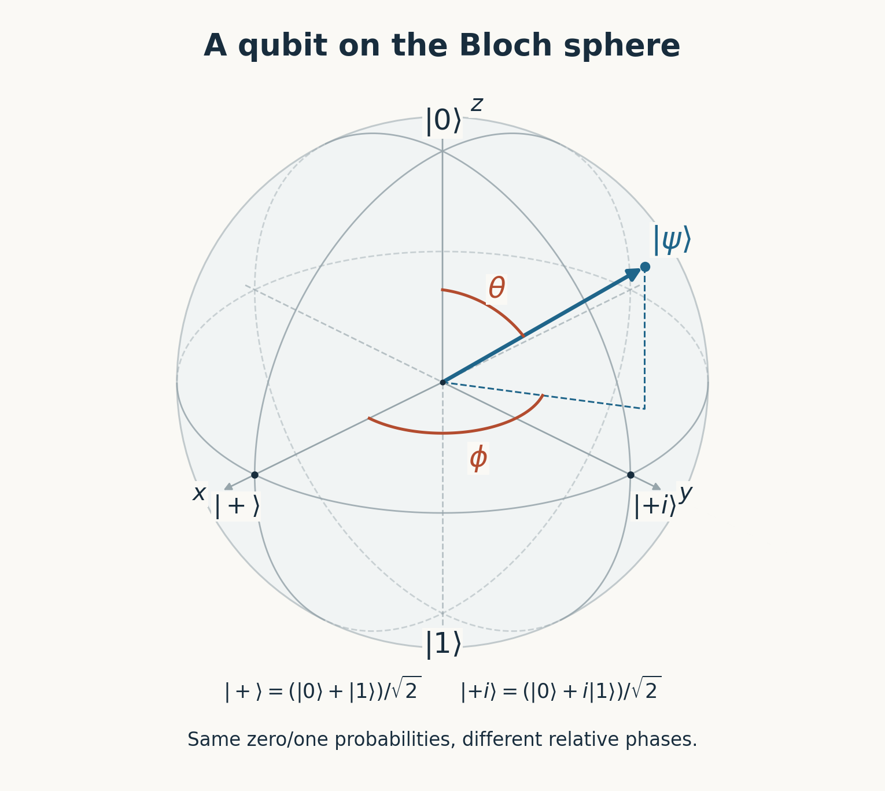
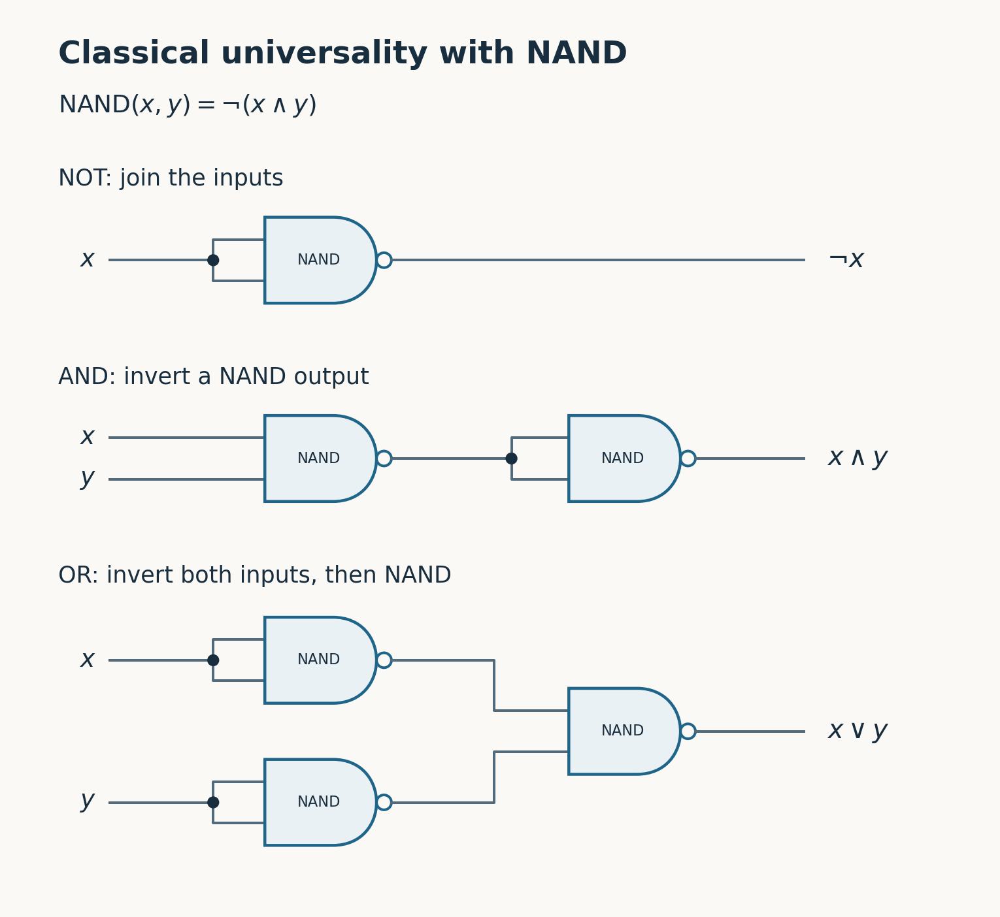
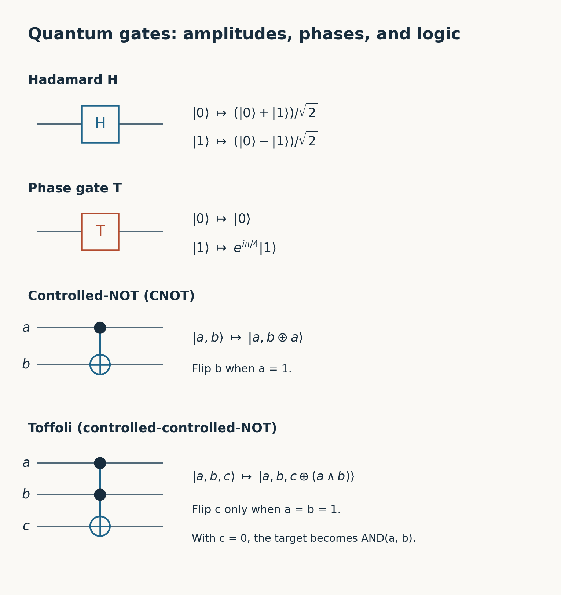
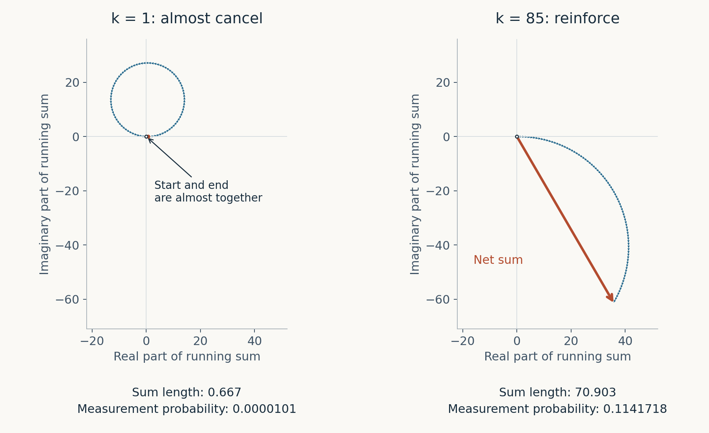
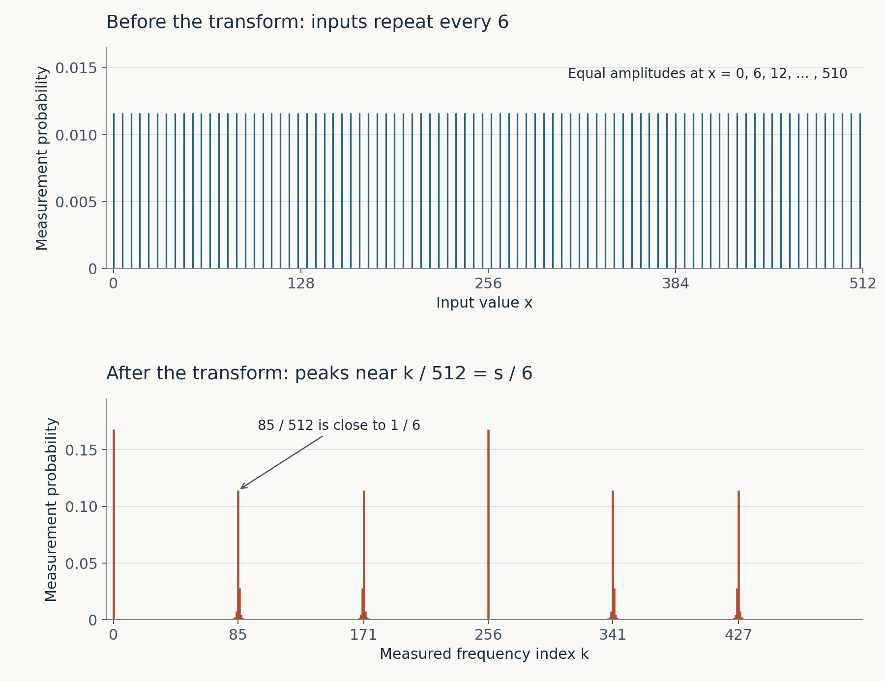

Public-key cryptography lets computers establish shared secrets over untrusted networks and verify digital signatures. We use it when a browser authenticates a website, an SSH client authenticates a server, or an operating system checks a software update's signature.

A sufficiently capable quantum computer could recover the private keys behind much of the public-key cryptography we use. It could read communications protected by vulnerable key exchanges and forge signatures that we rely on to authenticate people, computers, and software updates.

The machine needed to do this is called a *cryptographically relevant quantum computer*, or CRQC. It must be able to complete a cryptographic attack at a useful key size and within a useful amount of time.

One target is [RSA](https://people.csail.mit.edu/rivest/Rsapaper.pdf), a public-key cryptosystem for encryption and digital signatures, named for Rivest, Shamir, and Adleman. For encryption, a sender uses the recipient's public key, and the recipient decrypts with the private key. For signatures, the owner signs with the private key, and others verify the signature with the public key.

RSA constructs its key pair using two large, distinct primes, $p$ and $q$. Their product, called the *modulus*, is part of the public key:

$$
N=pq.
$$

Multiplying the primes is easy. Recovering them from a properly chosen, sufficiently large $N$ is beyond the reach of the best known classical factoring methods. Someone who factors $N$ can reconstruct the private key from the public key. That compromises both RSA encryption and RSA signatures.

[Diffie–Hellman key exchange](https://ee.stanford.edu/~hellman/publications/24.pdf) lets two parties establish a shared secret over a public network. They can use that secret to derive keys for encrypting their traffic. It relies on a different mathematical problem from factoring. In the modular-arithmetic version, they agree on a suitable prime $p$ and a public base $g$. Alice publishes $g^a\bmod p$ and Bob publishes $g^b\bmod p$. Their exponents remain secret. Each can calculate $g^{ab}\bmod p$ using the other person's public value and their own exponent. An eavesdropper sees the public values, but recovering an exponent requires solving a *discrete logarithm* problem. Recovering either exponent lets an eavesdropper calculate the shared secret.

**Elliptic-curve cryptography (ECC)** is a family of public-key schemes for key exchange and digital signatures. Its arithmetic adds points on an elliptic curve. A public key is a point $P=aG$, obtained by adding a publicly known point $G$ to itself $a$ times. The secret is $a$. Classical attacks on well-chosen curves are expensive, which allows much shorter keys than RSA at comparable classical security levels. But [quantum discrete-logarithm algorithms apply to elliptic curves too](https://arxiv.org/abs/1706.06752), making their key exchanges and digital signatures vulnerable.

A mathematical **group** is a set with an associative combining operation, an identity element, and an inverse for each element. In an **abelian group**, combining two elements in either order gives the same result. These quantum attacks exploit periods and discrete logarithms in such groups when their operations can be computed efficiently. Factoring and discrete logarithms are the problems on which these cryptosystems depend. Merely using a group does not mean a cryptosystem's security depends on either problem.

[Peter Shor's result](https://arxiv.org/abs/quant-ph/9508027) makes factoring and discrete logarithms possible in polynomial time on a suitable quantum computer. Polynomial time means that the number of operations grows as a polynomial in the number of bits used to describe the problem. Increasing an RSA key's length makes the quantum attack more expensive, but it does not restore the mathematical obstacle that protects it against known classical attacks.

A **physical qubit** is a physical system in which we use two distinguishable quantum states to represent $|0\rangle$ and $|1\rangle$. They might be two internal states of an atom or ion, or two energy levels of a superconducting circuit. We must be able to prepare the system, manipulate it, couple it to other qubits, and measure it.

A **logical qubit** is encoded across multiple physical qubits using a **quantum error-correcting code**: a mathematical scheme that adds redundancy so errors can be detected and corrected. A CRQC needs enough logical qubits, reliable gates, and an enormous amount of classical computation to keep the quantum computation working.

The notation $|0\rangle$ and $|1\rangle$, pronounced “ket zero” and “ket one,” denotes two basis vectors, just as $(1,0)$ and $(0,1)$ do in linear algebra. A **superposition** is a normalized linear combination of them:

$$
|\psi\rangle=\alpha|0\rangle+\beta|1\rangle.
$$

The coefficients $\alpha$ and $\beta$ are called **amplitudes**. The pair $(\alpha,\beta)$ is the state vector in this basis. Measuring in this basis gives zero with probability $|\alpha|^2$ and one with probability $|\beta|^2$, with $|\alpha|^2+|\beta|^2=1$.

A complex amplitude $\rho e^{i\gamma}$ has magnitude $\rho$ and **phase** $\gamma$, its angle in the complex plane. Euler's formula gives $e^{i\gamma}=\cos\gamma+i\sin\gamma$, where $i^2=-1$. The relative phase is the difference between the two amplitudes' angles.

When an operation combines contributions to the same measurement outcome, their amplitudes add before we take the squared magnitude. Contributions with matching phases reinforce one another; opposing contributions can cancel. This is **interference**.

A **quantum gate** acts on the state vector. For the computation between measurements, it is a *unitary* transformation: a reversible linear map that preserves the sum of the squared magnitudes of the amplitudes, keeping total probability equal to one.

A **pure state** is one described by a single state vector. The usual geometric representation is the [Bloch sphere](https://quantum.cloud.ibm.com/learning/en/courses/general-formulation-of-quantum-information/density-matrices/bloch-sphere). Ignoring a common phase multiplying the entire vector, which does not change measurement probabilities, we can write a pure single-qubit state as

$$
|\psi\rangle=\cos(\theta/2)|0\rangle
+e^{i\phi}\sin(\theta/2)|1\rangle.
$$

*The polar angle $\theta$ sets the measurement probabilities: $\cos^2(\theta/2)$ for zero and $\sin^2(\theta/2)$ for one. The angle $\phi$ is the relative phase between the two amplitudes. Every point on the equator gives equal zero/one probabilities, although those states behave differently in subsequent operations.*

A pure state corresponds to a point on the sphere's surface. Preparing $|0\rangle$ or $|1\rangle$ with equal classical probabilities gives a statistical mixture at the center; preparing $(|0\rangle+|1\rangle)/\sqrt2$ gives a pure state on the equator. A reversible single-qubit gate moves the point by rotating the sphere's radius vector. This is what “rotation” means here: a controlled change of the quantum state. A relative phase shift moves the point around the vertical axis while preserving its zero/one measurement probabilities.

A classical circuit can be built entirely from NAND gates, or entirely from NOR gates. Each is [universal for Boolean logic](https://ocw.mit.edu/courses/6-004-computation-structures-spring-2017/pages/c4/c4s1/): it can express every Boolean function, given enough gates and wires. For NAND, tying the two inputs together produces NOT. Negating a NAND output produces AND. Applying NAND to two inverted inputs produces OR, by De Morgan's law.

*The small circle at a gate's output means inversion. NAND alone can build NOT, AND, and OR; NOR has the same universality property. Practical circuit designs use a broader gate library to improve area, power, and delay.*

For $n$ qubits, the state vector has $2^n$ amplitudes, one for each possible $n$-bit string. Two qubits have four amplitudes; three have eight. The notation $|a,b,c\rangle$ labels the basis state for the bit string $abc$: its amplitude is one and all other entries are zero.

To implement Boolean logic with quantum gates, the computation must be reversible. An AND gate maps three different inputs to zero, so its output cannot tell us which input was supplied. We can implement that Boolean function reversibly by preserving its inputs and writing the result into an additional qubit.

That is one job for a **Toffoli gate**, also called controlled-controlled-NOT. It has two control qubits, $a$ and $b$, and a target qubit, $c$. For inputs with definite bit values, it leaves $a$ and $b$ unchanged and flips $c$ exactly when both controls are one:

$$
(a,b,c)\longmapsto
(a,b,c\oplus(a\land b)).
$$

$\oplus$ is exclusive-or and $\land$ is AND. Start the target at zero and it receives $a\land b$. Apply the gate twice and the original state is restored. Together with simpler reversible gates, [Toffoli gates build adders, multipliers, and other Boolean computations](https://quantum.cloud.ibm.com/learning/en/courses/fundamentals-of-quantum-algorithms/quantum-algorithmic-foundations/simulating-classical-computations). In a quantum circuit, the operation acts on superpositions without measuring the controls. A reversible arithmetic circuit acts on a superposition of inputs while preserving their phase relationships.

Reversible Boolean gates alone permute the possible bit strings. Quantum universality also requires control over superpositions and phases. The **Hadamard gate**, $H$, replaces a qubit's zero and one amplitudes $(u,v)$ with $((u+v)/\sqrt2,(u-v)/\sqrt2)$. The **T gate** advances the phase of the one component relative to the zero component by $\pi/4$. **CNOT**, or controlled-NOT, flips a target qubit when a single control qubit is one, leaving the control unchanged.

The Hadamard rule shows why phase matters. The amplitude pairs $(1,1)/\sqrt2$ and $(1,-1)/\sqrt2$ both give equal zero/one probabilities when measured. After a Hadamard, the first gives zero with certainty and the second gives one with certainty.

*Time runs from left to right. A filled dot is a control; a circled plus is a NOT target. The basis-state mappings shown for CNOT and Toffoli extend linearly to superpositions.*

For two independent qubits in pure states, the amplitude of each bit pair is the product of one amplitude from each qubit. Now start with both qubits at zero, apply a Hadamard to the first, and use that qubit as the control of a CNOT targeting the second. The resulting amplitudes are $1/\sqrt2$ for `00` and `11`, and zero for `01` and `10`. No two single-qubit amplitude lists can produce this: nonzero products for `00` and `11` would require nonzero products for `01` and `10` as well. This is **entanglement**. The pure state of the pair cannot be written as separate state vectors for its two parts.

Sequences of [H and T gates can approximate any single-qubit unitary operation](https://arxiv.org/abs/quant-ph/9906054), up to an unobservable overall phase. CNOT supplies the interaction between qubits. Any unitary operation on several qubits can be decomposed into [single-qubit operations and CNOT gates](https://arxiv.org/abs/quant-ph/9503016). This makes $\{H,T,\mathrm{CNOT}\}$ **universal for quantum computation**: circuits built from them can approximate any unitary operation to any desired accuracy. More precision generally requires more gates.

A digital circuit represents zero and one by ranges of voltages. Small disturbances within those ranges can be removed as gates regenerate the signal. A qubit must preserve the amplitudes and relative phase needed by the computation. An unwanted phase change can spoil the answer even when the probabilities of immediately measuring zero or one have not changed.

Physical qubits interact with their surroundings. An excited (higher-energy) state can lose energy to the environment and decay. Fluctuating electric or magnetic fields can change the relative phase. Uncontrolled interaction with the environment can carry away information about the qubit and destroy **coherence**, the phase relationships needed for interference. These processes are called [relaxation and dephasing](https://quantum.cloud.ibm.com/learning/en/courses/tools-for-quantum-advantage/noise-and-errors).

Control introduces further opportunities for error. A microwave or laser pulse can change the amplitudes or relative phase by the wrong amount. A signal intended for one qubit can disturb its neighbor. The engineering problem is to suppress unwanted interactions while retaining the deliberate interactions needed to compute. Cooling, shielding, vacuum systems, and precisely controlled fields address different parts of that problem, depending on the hardware.

The encoding of a logical qubit distributes its information so that certain errors can be detected and corrected without learning the encoded amplitudes. It is not a collection of identical backups: the [no-cloning theorem](https://quantum.cloud.ibm.com/learning/en/courses/basics-of-quantum-information/quantum-circuits/limitations-on-quantum-information) rules out copying an arbitrary unknown quantum state.

Error-correction circuits repeatedly measure relationships among the physical qubits, according to the chosen encoding scheme. The checks give the same expected results for all valid logical states, but physical errors can change those results. That lets us detect errors without learning the encoded logical amplitudes. The resulting patterns of check results are called *error syndromes*. A **classical decoder** is an algorithm that interprets those patterns to infer likely errors and determine corrections. More physical qubits can provide stronger protection when the physical operations are reliable enough for the chosen encoding and decoder. There is no fixed conversion rate from physical qubits to logical qubits.

Given RSA's public modulus $N$, Shor's factoring algorithm divides the work between quantum and classical processors. The quantum circuit produces a sample carrying information about a period. The classical processor recovers a candidate period, checks it, and calculates the factors. The quantum gates determine the probabilities of the possible samples; they do not test candidate factors.

To turn a period into factors, choose $a$ relatively prime to $N$, and consider

$$
f(x)=a^x\bmod N.
$$

The smallest positive $r$ for which $a^r\equiv1\pmod N$ is the *order* of $a$ modulo $N$, and it is the period of $f$.

The residues relatively prime to $N$ form a finite group under multiplication modulo $N$. Their number, $\varphi(N)$, is Euler's totient. The powers of $a$ form a **subgroup**, a subset that is itself a group under the same operation. This subgroup has $r$ elements. [**Lagrange's theorem**](https://ocw.mit.edu/courses/18-703-modern-algebra-spring-2013/df580757da0149c376f1fda29bf82a91_MIT18_703S13_pra_l_3.pdf) says that the size of a subgroup divides the size of the group, so $r$ divides $\varphi(N)$. Since $\varphi(N)<N$ for $N>1$, we know $r<N$. We will use that bound when interpreting the quantum measurement; we do not need to calculate $\varphi(N)$ first.

If $r$ is even, set $z=a^{r/2}\bmod N$. Then

$$
z^2\equiv1\pmod N,
\qquad
(z-1)(z+1)\equiv0\pmod N.
$$

Each prime factor of $N=pq$ must divide $z-1$ or $z+1$, because $N$ divides their product. If both primes divided the same term, $z$ would be $1$ or $-1$ modulo $N$. When neither is true, the factors are split between the two terms. Euclid's algorithm finds them by calculating the greatest common divisors $\gcd(z-1,N)$ and $\gcd(z+1,N)$. Finding the period is the expensive step on a classical computer.

For a worked example, take $N=21$.

**1. Set up the registers.** The classical processor chooses $a=2$ and checks $\gcd(2,21)=1$. A **register** is a group of qubits whose possible values we label with binary integers. We use nine logical qubits for the input register, representing values $0$ through $511$, and five for the result register, which must hold residues $0$ through $20$. The arithmetic also needs temporary qubits. We chose an input range of size $Q=512$ because $Q\geq N^2$ gives the later frequency measurement enough precision.

For a systems programmer, a useful mathematical model is a table indexed by the pair `(input, result)`, with a complex amplitude in each entry. This describes the joint state of the qubits; it is not a table stored in classical RAM. Measuring both registers returns one pair, with probability equal to the squared magnitude of its amplitude. We can calculate with the full table in a small simulation, but measurement does not let us read it out.

Initially the input register holds $0$ and the result register holds $1$. The entry `(0, 1)` has amplitude one; every other entry has amplitude zero.

**2. Give every input the same amplitude.** Apply a Hadamard gate to each input qubit. In the joint amplitude table, it acts on pairs of entries whose input values differ only in that bit, using the sum-and-difference rule above. Starting with one nonzero entry, the first gate produces two equal nonzero amplitudes, the second produces four, and so on. After nine gates, all 512 entries `(x, 1)` have amplitude $1/\sqrt{512}$. Their squared magnitudes sum to one.

**3. Compute the modular powers.** Write $x=\sum_{j=0}^{8}x_j2^j$, where $x_j$ are its binary digits. The classical processor precomputes $c_j=2^{2^j}\bmod21$: start with $c_0=2$, then repeatedly square the previous value and take the remainder modulo $21$. The nine constants are $2,4,16,4,16,4,16,4,16$. Multiplying the constants for the nonzero bits of $x$, reducing modulo $21$, gives $2^x\bmod21$.

For each input bit $x_j$, a controlled multiplication circuit multiplies the result by $c_j$ modulo $21$ when that bit is one, and leaves it alone otherwise. For input $x=6=2+4$, the active multipliers are $4$ and $16$: the result changes from $1$ to $4$ to $64\bmod21=1$. Each multiplication block contains many reversible gates. The input qubits control those gates without being measured, and the arithmetic reverses its temporary calculations to restore the workspace. Workspace records that distinguish inputs producing the same result would prevent their contributions from interfering later. [IBM's account of order finding](https://quantum.cloud.ibm.com/learning/en/courses/fundamentals-of-quantum-algorithms/phase-estimation-and-factoring/shor-algorithm) describes this construction.

Modular multiplication is reversible because each $c_j$ is relatively prime to $21$: it permutes the residues $0$ through $20$ without merging any two of them. Multiplication by $4$, for example, is undone by multiplication by $16$, since $4\cdot16\bmod21=1$. The unused result values $21$ through $31$ can be left unchanged.

The circuit moves the amplitude from each entry `(x, 1)` to `(x, 2^x mod 21)`. It applies this rule to the whole superposition by linearity. The first few occupied entries are:

| Input $x$ | Result $2^x\bmod21$ | Amplitude |
| --- | --- | --- |
| 0 | 1 | $1/\sqrt{512}$ |
| 1 | 2 | $1/\sqrt{512}$ |
| 2 | 4 | $1/\sqrt{512}$ |
| 3 | 8 | $1/\sqrt{512}$ |
| 4 | 16 | $1/\sqrt{512}$ |
| 5 | 11 | $1/\sqrt{512}$ |
| 6 | 1 | $1/\sqrt{512}$ |
| 7 | 2 | $1/\sqrt{512}$ |
| $\vdots$ | $\vdots$ | $\vdots$ |

The input and result registers are now entangled. If they were independent, each would have its own amplitude list. The amplitude for any pair `(x, y)` would equal the input amplitude for `x` multiplied by the result amplitude for `y`.

Our table shows why. The pairs `(0, 1)` and `(1, 2)` have nonzero amplitudes, but `(0, 2)` and `(1, 1)` have zero amplitudes. Independent lists that allow inputs 0 and 1 and results 1 and 2 would also allow those cross-pairs. They cannot reproduce this table. We must describe the quantum state of the registers jointly.

A classical mixture of the same pairs could have the same measurement probabilities at this stage, but it would not preserve the phase relationships needed for the later interference. The circuit has created the entangled state using only $N$, $a$, and the input bit positions; it was never given the period or the factors.

**4. Select a regularly spaced set of inputs.** Measure the result register. Suppose it returns $1$. The entries consistent with that result have inputs $0,6,12,\ldots,510$. There are 86 of them, each with probability $1/512$, so this result occurs with probability $86/512$. We add probabilities because the input values still distinguish the entries. Their amplitudes have not interfered.

After observing that result, all other entries disappear from the conditional state. Each remaining amplitude becomes $1/\sqrt{86}$ so that the remaining probabilities sum to one. Another measured result would select a different starting point with the same spacing.

We can see the spacing in our mathematical description. Measuring the input register now would give us only one of those values. We need to change the amplitudes so that a measurement carries useful information about the spacing.

**5. Define and apply the Fourier transform.** A discrete Fourier transform turns a list of values into sums that reveal its repeating patterns. The [**quantum Fourier transform (QFT)**](https://quantum.cloud.ibm.com/learning/en/modules/computer-science/qft) applies that transformation to a register's complex amplitudes. For a register with $Q$ possible values, call an input value $x$ and an output value $k$, both between $0$ and $Q-1$. If $A_{\mathrm{in}}[x]$ is the amplitude of input $x$, the QFT produces

$$
A_{\mathrm{out}}[k]=\frac{1}{\sqrt Q}\sum_{x=0}^{Q-1}A_{\mathrm{in}}[x]e^{2\pi i xk/Q}.
$$

Each occupied input contributes to every possible output. For a fixed output $k$, the factor $e^{2\pi i xk/Q}$ advances the phase by $2\pi k/Q$ as $x$ increases by one. Different values of $k$ give different rates of phase advance, the frequencies of the transform. Contributions to the same output add before we square their magnitude to obtain its probability. In our factoring example, $Q=512$, so $k$ is a nine-bit integer.

The transform can be built from elementary gates. The circuit below implements the same Fourier formula for three qubits, so $Q=8$. A controlled phase gate $P(\theta)$ multiplies an amplitude by $e^{i\theta}$ when both its control and target bits are one; it leaves the other amplitudes unchanged.

*The wires correspond to binary place values 4, 2, and 1. Read from left to right. A filled dot is a control; the connected crosses exchange the two outer qubits.*

Follow input $x=5$, whose bits are `101`. For this input, each control still has a definite bit value when its phase gate acts, so we can track the qubits separately. Each amplitude pair below lists the amplitude for zero first, then for one. The first Hadamard gives the top qubit amplitudes $(1,-1)/\sqrt2$. The middle control is zero, so the first phase gate does nothing. The bottom control is one, so the next gate multiplies the top qubit's amplitude for one by $e^{i\pi/4}$, producing $(1,e^{5\pi i/4})/\sqrt2$. On the middle wire, its Hadamard and controlled phase produce $(1,i)/\sqrt2$. The bottom Hadamard produces $(1,-1)/\sqrt2$.

After exchanging the outer qubits, the three amplitude pairs, from top to bottom, are $(1,-1)/\sqrt2$, $(1,i)/\sqrt2$, and $(1,e^{5\pi i/4})/\sqrt2$. For an output with bits $k_2,k_1,k_0$, select the corresponding amplitude from each pair and multiply them. Writing $k=4k_2+2k_1+k_0$, the result is

$$
\frac{(-1)^{k_2}i^{k_1}e^{5\pi i k_0/4}}{\sqrt8}
=\frac{e^{2\pi i\,5k/8}}{\sqrt8}.
$$

That is the Fourier amplitude for input $5$ and output $k$. Other inputs supply different signs and activate different phase gates. Linearity gives the transform of a superposition by adding those contributions. Extending this pattern to nine qubits uses nine Hadamards, 36 controlled phase gates, and four swaps. Its gate settings are fixed by the register size. With H, T, and CNOT as the available logical gates, the controlled phase operations must themselves be built from sequences of those gates, approximating the small angles to the required accuracy.

Now apply that nine-qubit circuit to the input state from step 4. Its nonzero inputs are $x=6j$, for $j=0,\ldots,85$, so the calculation becomes

$$
A_{\mathrm{out}}[k]=\frac{1}{\sqrt{86\cdot512}}\sum_{j=0}^{85}e^{2\pi i(6j)k/512},
\qquad P(k)=|A_{\mathrm{out}}[k]|^2.
$$

At $k=128$, the terms alternate between $+1$ and $-1$. There are 43 of each, so they cancel exactly and $P(128)=0$. At $k=1$, the terms go almost once around the complex plane and nearly cancel, giving $P(1)\approx0.0000101$.

At $k=85$, the angle between successive terms is $2\pi\cdot510/512$, almost a full turn. Successive contributions point in similar directions and reinforce. Their sum has magnitude about $70.9$, giving

$$
P(85)\approx\frac{70.9^2}{86\cdot512}\approx0.1142.
$$

$85$ is about 11,000 times as likely as $1$. No gate has recognized a correct answer. Addition and cancellation of complex amplitudes have changed the odds.

*Each blue arrow is one term in the sum. Red marks the net contribution from the start to the end, before normalization. Both panels use the same scale. Squaring the normalized length gives the measurement probability.*

For an input state with spacing $r$, the phase advances by $2\pi rk/Q$ between successive contributions to output $k$. When $rk/Q$ is close to an integer $s$, that advance is close to a whole number of turns, so successive contributions reinforce. Solving for $k/Q$ gives peaks near $k/Q=s/r$. For our example, the peaks are near $k=0,85,171,256,341,427$. A measurement samples one value from this distribution.

*For $N=21$, $a=2$, and $Q=512$, the upper plot shows the input state after measuring result $1$. The lower plot shows the probabilities after the Fourier transform.*

**6. Turn a sample into factors.** Suppose measurement of the input register gives $k=85$. The quantum part of this run is finished. The classical processor forms $85/512$ and uses **continued fractions** to find rational approximations with small denominators. The first division is $512=6\cdot85+2$, so

$$
\frac{85}{512}=\frac{1}{6+2/85}\approx\frac16.
$$

Continuing Euclid's divisions gives $85=42\cdot2+1$ and $2=2\cdot1$. Substituting back gives $85/512=1/(6+1/(42+1/2))$. The integer part is $0/1$; truncating the nested fraction at successive levels gives $1/6$, $42/253$, and $85/512$. By the bound from Lagrange's theorem, the order is less than $21$, so only denominators $1$ and $6$ are candidates. One fails because $2^1\bmod21=2$; six passes because $2^6\bmod21=1$.

Six is even, so calculate $z=2^{6/2}\bmod21=8$. Eight is neither $1$ nor $20$, the residue representing $-1$ modulo $21$. The factors are

$$
p=\gcd(8-1,21)=7,
\qquad
q=\gcd(8+1,21)=3.
$$

Finally, verify that both factors are greater than one and $pq=21$. The measured integer $85$ has led us to the factors $7$ and $3$ through classical arithmetic.

The choice $Q\geq N^2$ supplies the precision needed for this reconstruction. For a measurement $k$ nearest to a peak at $sQ/r$,

$$
\left|\frac{k}{Q}-\frac{s}{r}\right|\leq\frac{1}{2Q}<\frac{1}{2r^2},
$$

because $r<N$. At this accuracy, $s/r$ in lowest terms appears among the [continued-fraction approximations](https://quantum.cloud.ibm.com/learning/en/courses/fundamentals-of-quantum-algorithms/phase-estimation-and-factoring/shor-algorithm). Its denominator is $r$ when $s$ and $r$ are relatively prime; otherwise it is a divisor of $r$.

A different sample may require another run. For example, $k=256$ gives $256/512=1/2$. Its denominator suggests $r=2$, but $2^2\bmod21=4$, so that candidate fails the check. The outcome $k=0$ supplies no period information. Both are prominent peaks in the graph: a large measurement probability does not guarantee enough information to factor $N$. A new sample requires reinitializing the qubits and rerunning the quantum circuit. Measuring the finished register again would give the same value. If a recovered order is odd or gives $z=-1\pmod N$, we choose another base $a$.

The speedup comes from obtaining period information without enumerating powers until they repeat. For $Q=2^m$, the Fourier circuit uses $O(m^2)$ gates, and the reversible modular arithmetic also has polynomial cost in the bit length of $N$. Implementing the phase gates accurately on error-corrected hardware adds work. At RSA sizes, the CRQC must carry out this computation with enough logical qubits and sufficiently reliable gates to preserve the interference throughout.

The discrete-logarithm version uses related interference in two dimensions. Let $g$ generate a cyclic group of known prime order $\ell$, so its powers run through all $\ell$ elements. Suppose $y=g^s$, and $s$ is secret. Take $u$ and $v$ modulo $\ell$ and consider

$$
h(u,v)=g^u y^v=g^{u+sv}.
$$

Changing $(u,v)$ by $(-s,1)$ leaves the value unchanged. Prepare a uniform superposition of the pairs $(u,v)$ and compute $h(u,v)$ into a third register. Use the Fourier sum with $Q=\ell$ on each input register, with output frequencies $c$ and $d$.

For any one result value, the input pairs that produce it differ by multiples of $(-s,1)$. Each pair contributes a Fourier phase $2\pi(uc+vd)/\ell$ to output $(c,d)$. Moving by $(-s,1)$ advances that phase by $2\pi(d-sc)/\ell$. Across the $\ell$ input pairs, the contributions cancel unless that advance is a whole number of turns. The measured frequencies satisfy

$$
d\equiv cs\pmod\ell.
$$

For a nonzero $c$, calculate $s=dc^{-1}\bmod\ell$ and check that $g^s=y$. The inverse $c^{-1}$ is the number that multiplies $c$ to give one modulo $\ell$; it exists because $\ell$ is prime. If $c=0$, take another sample. For an elliptic curve, write $P=sG$ and use the function $uG+vP$. Changing $(u,v)$ by $(-s,1)$ again leaves the result unchanged, so the same Fourier argument recovers $s$.

The logical qubits must support reliable gates as well as reliable storage. For factoring, modular exponentiation accounts for much of the work. The Fourier transform is a comparatively small part of the circuit.

The **Clifford gates** are the operations that can be built from $H$, CNOT, and the phase gate $S$, which advances the relative phase by $\pi/2$. Starting with qubits initialized to $|0\rangle$, Clifford gates and measurements in the zero/one basis alone give circuits that can be simulated efficiently on a classical computer. They do not provide universal quantum computation.

The T and Toffoli gates are **non-Clifford** operations: they lie outside that restricted family. A common error-correcting scheme, the **surface code**, uses local checks on a two-dimensional arrangement of qubits. Computation must be **fault-tolerant**, meaning that errors in individual components, including the correction machinery, are contained rather than allowed to spread into an uncorrectable logical error.

The T gate must act on the encoded logical amplitudes while preserving the protection of the code. Applying physical T gates independently to the qubits of a surface code [does not implement a protected logical T](https://arxiv.org/abs/1206.1609).

In surface-code architectures, supplying non-Clifford operations requires additional machinery. One approach consumes specially prepared auxiliary states called **magic states**. For example, the state used to supply a T gate is

$$
|A\rangle=
\frac{|0\rangle+e^{i\pi/4}|1\rangle}{\sqrt2}.
$$

For a logical data qubit with amplitudes $(\alpha,\beta)$, apply a CNOT with the data qubit as control and the magic-state qubit as target, then measure the target. Outcome zero leaves the data with amplitudes $(\alpha,e^{i\pi/4}\beta)$, the desired T operation. Outcome one leaves $(e^{i\pi/4}\alpha,\beta)$. Applying S changes this to $e^{i\pi/4}(\alpha,e^{i\pi/4}\beta)$, the same T result up to an unobservable common phase. The auxiliary state has been measured and must be replaced for another T gate.

This [construction](https://arxiv.org/abs/quant-ph/0403025) is called **gate injection**: consuming an auxiliary state to implement a gate. **Feed-forward** means using a measurement result to choose a subsequent operation, such as the S correction above. Preparing the resource state supplies what the Clifford operations cannot do alone.

A **magic-state factory** dedicates physical qubits, gates, and time to producing those states reliably. Distillation protocols consume multiple imperfect resource states to obtain fewer, cleaner ones. Other approaches, including [magic-state cultivation](https://research.google/pubs/magic-state-cultivation-on-a-superconducting-quantum-processor/), change how the states are prepared and checked. A computation that needs these states must wait if the factory has not produced them.

*A factory supplies auxiliary quantum states to the computation. Clifford operations, measurements, and classical feedback use them to enact non-Clifford gates. Encoded states throughout this system still require error correction.*

In March 2026, Google's researchers reported two circuit designs for a 256-bit elliptic-curve discrete-logarithm problem:

| Logical qubits | Toffoli gates |
| --- | --- |
| Fewer than 1,200 | Fewer than 90 million |
| Fewer than 1,450 | Fewer than 70 million |

These are **logical** resource estimates. Each protected Toffoli operation can require many physical operations and additional auxiliary states. Turning a gate count into a runtime requires the circuit's dependencies, opportunities for parallelism, factory throughput, and classical response times.

Under its superconducting-hardware assumptions, [Google's study](https://research.google/blog/safeguarding-cryptocurrency-by-disclosing-quantum-vulnerabilities-responsibly/) estimated fewer than 500,000 physical qubits and a runtime of minutes for this elliptic-curve attack.

For RSA-2048, whose public modulus is 2,048 bits long, [Craig Gidney's 2025 estimate](https://arxiv.org/abs/2505.15917) put the physical requirement below a million noisy qubits, with a runtime below a week, under specified assumptions about gate errors, connectivity, error-correction cycles, and classical control. These numbers change as algorithms, codes, and hardware improve. There is no single qubit count that defines a CRQC independently of its target and operating conditions.

Error correction remains a substantial part of the machine. An uncorrected physical error probability that looks small for one gate is disastrous over a long computation. As a simple illustration, a billion vulnerable operations, each independently failing with probability $10^{-6}$, would produce about a thousand failures on average. We need a much smaller *logical* error rate across the whole computation.

An error-correction scheme has an **error threshold**: under its assumed noise model, this is the physical error level below which adding redundancy improves protection. [Surface-code constructions](https://arxiv.org/abs/1208.0928) show how to do this, including the additional machinery needed for a universal set of logical gates.

The syndrome measurements keep the classical decoder busy throughout the calculation. It must infer the likely errors and determine the corrections, often tracking them in a classical record rather than immediately applying a physical correction.

Both the bandwidth and the computation can be enormous. If 100,000 error checks each produce one syndrome bit every microsecond, the raw stream is $10^{11}$ bits per second: **12.5 gigabytes per second**. An illustrative larger system with ten million such checks would produce **1.25 terabytes per second**, before compression or communications overhead. The measurements continue throughout the calculation, potentially for hours or days.

The decoder must compare check results from neighboring qubits over successive rounds to infer likely error patterns. Under their surface-code and decoder assumptions, [Camps and colleagues](https://daancamps.com/publication/hardware-evaluation/) estimated **petaflop-scale classical capacity** for decoding in a 1,000-logical-qubit chemistry calculation: roughly $10^{15}$ floating-point operations per second. Their model converts CPU decoder timings into equivalent floating-point capacity.

Throughput and latency both matter. The classical system must keep pace with incoming measurements, and it must deliver the information needed by later quantum operations. A growing backlog slows the computation. Google's [Willow real-time decoding experiment](https://www.nature.com/articles/s41586-024-08449-y) ran error-correction rounds every $1.1$ microseconds, while decoder latency averaged $63$ microseconds. Several rounds can be in flight at once; the sustained processing rate must keep up with new rounds.

Reducing the logical-qubit requirement does not eliminate the physical-qubit overhead, the gate count, or the classical decoding workload. A CRQC is an integrated quantum and classical computer.

Conflating artificial intelligence with quantum computing is nonsense. Today's mainstream AI systems are trained and run on classical computers. Shor's algorithm does not depend on a trained model. There are specific research connections, including [neural networks for decoding quantum error syndromes](https://www.nature.com/articles/s41586-024-08148-8). In that work, classical software interprets the quantum processor's error measurements. It does not make the two technologies interchangeable. A sales pitch that simply bundles “AI” and “quantum” together is asking for your money with two buzzwords.

Post-quantum cryptography (PQC) supplies replacements for vulnerable key exchanges and signature schemes, using different mathematical assumptions. It runs on classical computers. NIST's [first three finalized standards](https://csrc.nist.gov/News/2024/postquantum-cryptography-fips-approved/) cover key establishment and digital signatures. Their security relies on mathematical problems that Shor's algorithm does not solve.

For readers interested in the algorithms, I have implemented classical and post-quantum cryptography in pure Rust. The code is available in my [cryptography repository](https://github.com/darrelllong/cryptography).

How soon a system needs to adopt post-quantum cryptography depends partly on how long its information must remain secret. An adversary can retain a vulnerable key exchange and the encrypted traffic associated with it, then attack the exchange when a suitable machine becomes available. NIST calls this [harvest now, decrypt later](https://www.nist.gov/cybersecurity-and-privacy/what-post-quantum-cryptography). Upgrading the systems later does not retrieve the copies already recorded.
