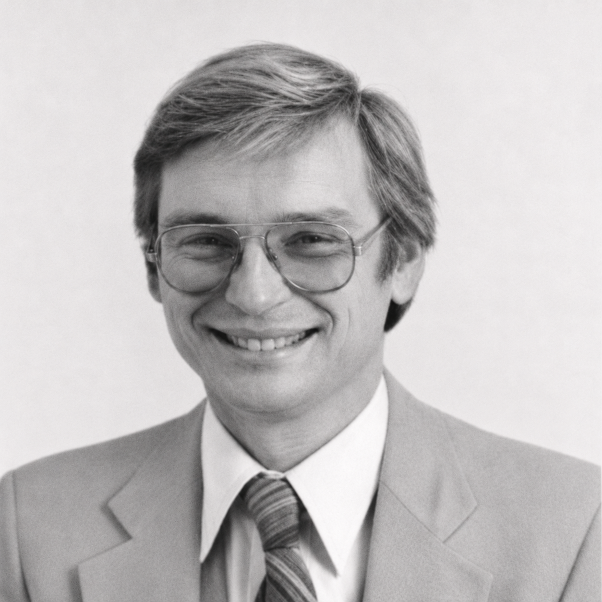

*Glen G. Langdon. Restored from his IBM badge photograph.*

Patrick Mantey recruited Glen Langdon to UC Santa Cruz to help build its engineering program. When I arrived in 1988, Glen was a welcoming presence. We later worked together on [REINAS, our environmental sensor network](/blog/2026-10-28-a-proud-war-criminal/), where Glen brought his expertise in data compression.

What I remember most about Glen is his kindness and generosity. He would often pay graduate students' tuition and stipends out of his own pocket.

I have put together an arithmetic-coding library and a file-compression utility in his honor. The library is called `arith`, and the utility is `acz`. Both carry the dedication: *To the memory of my colleague Glen G. Langdon.*

## Glen at IBM and Santa Cruz

In 1971, while at IBM, Glen returned to Brazil, where he had spent much of his childhood, to teach at the Escola Politécnica in São Paulo. His students designed and built *Patinho Feio*, the Ugly Duckling, an early Brazilian computer. He moved to IBM Research in San Jose in 1974. His [obituary in the Santa Cruz Sentinel](https://www.santacruzsentinel.com/obituaries/glen-george-langdon/) records eighteen U.S. patents, two books, and a fondness for puns, including jokes in Portuguese.

Glen was very proud that Scopus, the Brazilian computer company founded by members of the Patinho Feio group, named its headquarters building after him. His former student Edson Fregni records the tribute in [Marcia de Oliveira Cardoso's history of the project](https://merlintec.com/download/PatinhoFeio_low.pdf#page=119).

He also helped define what computer engineers should learn. Glen co-chaired the committee responsible for the IEEE's 1984 model curriculum in computer science and engineering. UCSC used that work in developing its own program. He joined the faculty full time in 1987, supervised the department's first Ph.D., awarded in 1992, and retired in 2003. J. J. Garcia-Luna-Aceves and Patrick Mantey describe that history in their [UCSC memorial](https://emeriti.ucsc.edu/Obituaries/LangdonGlen.pdf).

Glen died on March 11, 2014, at the age of seventy-seven.

## Arithmetic Coding

At IBM, Glen and Jorma Rissanen were central figures in the development of practical arithmetic coding. Their 1979 paper, “[Arithmetic Coding](https://doi.org/10.1147/rd.232.0149),” describes a broad family of these codes. Glen's 1984 paper, “[An Introduction to Arithmetic Coding](https://www.cs.cmu.edu/~aarti/Class/10704/Intro_Arith_coding.pdf),” explains the ideas and the engineering problems behind them. It is the starting point for this project.

Peter Elias, whom I never met, supplied a foundational idea behind arithmetic coding: computing a message's cumulative probability recursively from its symbol probabilities. Glen credits Elias's unpublished work in [the historical appendix to his paper](https://www.cs.cmu.edu/~aarti/Class/10704/Intro_Arith_coding.pdf#page=14), noting that Norman Abramson described it in his 1963 book *Information Theory and Coding*.

An arithmetic coder represents a message by repeatedly narrowing an interval. Start with $[0,1)$. Divide it among the possible symbols in proportion to their probabilities, retain the part belonging to the next symbol, and repeat inside that smaller interval. A likely symbol retains a large fraction of the interval. An unlikely symbol retains a small one.

For a simple example, suppose that $A$, $B$, and $C$ have fixed probabilities $1/2$, $1/4$, and $1/4$. To encode `ABC`:

| Symbols processed | Interval retained | Width |
|---|---|---|
| None | $[0,1)$ | $1$ |
| `A` | $[0,1/2)$ | $1/2$ |
| `AB` | $[1/4,3/8)$ | $1/8$ |
| `ABC` | $[11/32,12/32)$ | $1/32$ |

The final interval consists of binary fractions beginning `0.01011`. Those five bits identify the message, provided the decoder knows to recover three symbols. The decoder repeats the subdivisions and determines which part contains the encoded value at each step.

The example uses probabilities that are powers of two, so ordinary Huffman coding also needs five bits. Arithmetic coding becomes especially useful when probabilities do not line up so neatly. A symbol with probability $0.9$ has an ideal information cost of about $0.152$ bits. A binary Huffman code assigning a separate codeword to each of two possible symbols must still use one bit for each. Arithmetic coding lets successive symbols share the representation, so their fractional costs accumulate across the message. Witten, Neal, and Cleary give the classic comparison and implementation in “[Arithmetic Coding for Data Compression](https://web.stanford.edu/class/ee398a/handouts/papers/WittenACM87ArithmCoding.pdf).”

## The Model Does the Predicting

In `arith`, the model estimates the probability of each possible symbol and supplies the coder with cumulative frequency counts. The coder uses those counts to narrow its interval, without knowing what the data represent. The library can therefore serve different models and file formats.

If the model assigns conditional probabilities $p(x_i\mid x_1,\ldots,x_{i-1})$ to a sequence, its ideal coding cost is

$$
L = -\sum_{i=1}^{n}\log_2 p(x_i\mid x_1,\ldots,x_{i-1}).
$$

The implementation approaches that cost, with overhead from finite precision, termination, and file framing. Better predictions mean shorter output.

An adaptive model learns as it goes. Encoder and decoder start in the same state and update their models after each symbol, so both have the same probabilities available for the next one. There is no need to transmit a separate probability table.

## Making the Arithmetic Finite

An indefinitely shrinking interval would require unbounded precision. The general coder in `arith` instead maintains a closed interval with 32-bit endpoints and uses 64-bit intermediate products. If its current endpoints are $\ell$ and $h$, its width is $R=h-\ell+1$. For cumulative counts $c_\ell$, $c_h$, and total $T$, it computes

$$
\ell' = \ell + \left\lfloor\frac{R c_\ell}{T}\right\rfloor,
\qquad
h' = \ell + \left\lfloor\frac{R c_h}{T}\right\rfloor - 1.
$$

Both expressions use the old value of $\ell$. The frequency total is bounded by $2^{30}$, preserving a nonempty interval for every symbol with positive frequency.

When both endpoints lie in the lower half of the coding range, the next output bit is zero. When both lie in the upper half, it is one. The coder writes that bit and rescales the remaining interval. The awkward case is an interval confined to the middle half, straddling the midpoint. Its leading bit is still undecided. The implementation counts pending bits and resolves them when a later event settles the decision. This is the Witten–Neal–Cleary underflow technique; no bit already written has to be changed.

The library has two more arithmetic coders, one for binary decisions and one for multi-symbol intervals, that renormalize a byte at a time. This form is often called a range coder, after G. N. N. Martin's 1979 paper. It narrows the interval by the same rule and differs only in the unit it shifts out: a whole byte once the range has lost eight bits of precision, which reduces the work per decision. An addition to the low end of the interval can carry into bytes that have left the register, the carry-over problem of Glen's paper. The encoder holds back one byte and a count of the `0xFF` bytes after it until a later byte settles the carry, so nothing already written has to be changed.

## Five Models in One Utility

The current utility has five model settings. The option numbers select models; they are not all literal context orders.

| Option | Prediction model | Arithmetic coder |
|---|---|---|
| `-0` | Adaptive frequencies of the 256 byte values | Multi-symbol, bit normalization |
| `-1` | A separate byte-frequency table for each preceding byte | Multi-symbol, bit normalization |
| `-2` | Previous two bytes, with the next byte predicted bit by bit | Binary, byte normalization |
| `-3` | Prediction by partial matching, using contexts up to six bytes | Multi-symbol, byte normalization |
| `-4` | Context mixing, the default | Binary, byte normalization |

Every setting codes its predictions with an arithmetic coder. The settings differ in the model and in which of the library's coders suits the events the model produces.

Prediction by partial matching, or PPM, begins with the longest available context. If that context has never seen the next byte, it codes an escape and tries a shorter context. Symbols already ruled out are excluded from the shorter context's distribution. The model follows Dmitry Shkarin's published methods: binary contexts with their own escape estimates, inheritance of statistics when a new context is created, and an escape estimator that learns from the coding history.

The contexts are kept in a trie stored in two arrays. Each symbol of a context points to the context that follows it, and each context points to the same context less its oldest byte, so moving from one byte to the next follows a link and searches no table. When either array is full, the model restarts deterministically. An earlier version kept its contexts in a table grown by [Witold Litwin's linear hashing](/blog/2026-10-04-witold-litwin/); the trie replaced it because the links make the table searches unnecessary.

Context mixing combines several predictors for each bit. Some use recent byte contexts of different lengths, words, or sparse contexts. A match predictor looks for a previous occurrence of the recent byte sequence and predicts what followed it. Once the model detects a fixed record length, it also uses bytes in the corresponding positions of earlier records.

Two logistic mixers combine these predictions, learning weights as the data arrive. Adaptive probability maps then refine the result. The calculations use integer arithmetic throughout, so the encoder and decoder agree across machines.

The mixer's output is one probability for the next bit, and the binary arithmetic coder codes that bit with it. Every byte of a file compressed with `-4` passes through the coder as eight such decisions. An adaptive model feeding a binary arithmetic coder, each ignorant of the other's internals, is the arrangement Glen and Jorma Rissanen worked out at IBM.

## From a Coder to a File Compressor

`acz` is written in safe Rust, with no external package dependencies. It operates on files or as a Unix filter, using 16 MiB blocks by default. Each block starts with a fresh probability model, allowing parallel compression and decompression at the cost of losing learned context across block boundaries. Results are written in input order, and changing the worker count does not change the compressed bytes.

The memory budget controls how many workers can run. By default, the utility uses half the available physical memory, accounting for a smaller Linux cgroup limit when present, and falls back to 4 GiB if it cannot determine the limit. This budget covers the planned model and buffer allocations, rather than imposing a hard limit on total process memory.

The file format records the model, block parameters, and uncompressed lengths, so the decoder knows how to interpret each block and when to stop. CRC-64 checks cover the header, individual blocks, and reconstructed data. A block that would grow under compression is stored directly. Without repeat removal, the maximum expansion is 17 bytes per block plus 33 bytes per input file.

An optional `--dedup` stage removes long exact repetitions before statistical coding. It searches a sliding window, 256 MiB by default, and replaces matches of at least 256 bytes with references to earlier data. This applies the principle of encoding repeated regions by reference that we studied in our JACM paper, “[Compactly Encoding Unstructured Inputs with Differential Compression](/publications/26/)” (2002), discussed in my earlier [delta-compression post](/blog/2026-10-03-delta-compression/). It can exploit repetitions across block boundaries, although finding and reconstructing those references requires an ordered history.

## What the Measurements Show

The project includes measurements on Sebastian Deorowicz's [Silesia compression corpus](https://sun.aei.polsl.pl/~sdeor/index.php?page=silesia): twelve files totaling 211,938,580 bytes, including text, source code, executables, images, and databases. Each file was compressed separately. The programs ran single-threaded on the same Cortex-X925 core, and every decompressed result was compared byte for byte with its input.

The numbers are those of release 0.7.0. The times below are CPU seconds, calculated as the median of three whole-corpus totals of user plus system time. The `acz` runs use 16 MiB blocks. Silesia was used during development; the repository's report retains the input hashes, individual measurements, scripts, and build identities.

| Configuration | Compressed bytes | Percent of input | Compress (s) | Decompress (s) |
|---|---:|---:|---:|---:|
| `acz -4` | 42,443,079 | 20.03% | 152.09 | 159.56 |
| `xz -9` (5.4.5) | 48,795,480 | 23.02% | 63.89 | 1.60 |
| 7-Zip PPMd, order 6 (23.01) | 49,029,343 | 23.13% | 15.77 | 16.90 |
| `acz -3` | 50,601,960 | 23.88% | 20.28 | 19.73 |
| `zstd -19` (1.5.5) | 53,024,529 | 25.02% | 60.52 | 0.18 |
| `bzip2 -9` (1.0.8) | 54,506,769 | 25.72% | 9.22 | 3.96 |
| `gzip -9` (1.12) | 67,631,918 | 31.91% | 11.37 | 0.75 |
| `acz -2` | 69,610,084 | 32.84% | 6.12 | 9.54 |
| `acz -1` | 94,356,023 | 44.52% | 8.81 | 9.39 |
| `acz -0` | 127,167,804 | 60.00% | 10.02 | 10.31 |

Context mixing produces output 13.0% smaller than `xz -9` in aggregate, and smaller on every file in the corpus. It takes about 2.4 times as long to compress and 100 times as long to decompress. PPM produces output 4.6% smaller than `zstd -19` in about a third of the compression time, but with much more decompression time. It is 3.2% larger than 7-Zip's PPMd at the same order, which codes each file whole where `acz` restarts its model every 16 MiB, and it takes about 29% longer to compress and 17% longer to decompress.

For both PPM and context mixing, decoding takes about as long as encoding because both directions require the same prediction and training work. Compressors based on finding repeated strings can spend substantial effort searching during compression, then reconstruct much of the file by copying.

The report also gives sizes for two collections that played no part in development: 11,058 of the U.S. Census Bureau's public data files, 269.1 GB in all, and 688 files of Backblaze's hard drive statistics, 248.3 GB. Each file was compressed whole with one thread.

| Collection | `acz -4` | `xz -9` | `zstd -19` | `acz -3` |
|---|---:|---:|---:|---:|
| Census | 9.81% | 10.49% | 11.12% | 13.60% |
| Backblaze | 8.32% | 8.76% | 9.13% | 10.61% |

Context mixing is again the smallest. PPM, with its model restarted every 16 MiB, falls behind both dictionary coders on these large, repetitive files.

Enabling `--dedup` with context mixing changes the total to 42,462,366 bytes, slightly larger, while reducing compression and decompression time to 147.44 and 152.24 seconds. It is off by default: command overhead and changes to the model's context can outweigh the benefit of removing literal bytes.

## The Code and the Fellowship

The source is available at [github.com/darrelllong/acz](https://github.com/darrelllong/acz). With [Homebrew](https://brew.sh), `brew install darrelllong/tap/acz` builds and installs it. From the source, the workspace builds the `acz`, `unacz`, and `aczcat` commands:

```sh
cargo build --release

# Compress a file; the original is kept.
target/release/acz report.txt

# Check the compressed file without writing decoded output.
target/release/acz -t report.txt.acz

# Decode to standard output.
target/release/aczcat report.txt.acz

# Use PPM explicitly, or compress an archive with long-repeat removal.
target/release/acz -3 notes.txt
tar cf - documents/ | target/release/acz --dedup > documents.tar.acz
```

The project uses a BSD-style license with an additional requirement that the dedication to Glen be preserved in copies and derivative works.

At UCSC, the [Glen G. Langdon Fellowship](https://engineering.ucsc.edu/departments/computer-science-and-engineering/glen-langdon-prize/) is awarded annually to an entering graduate student in computer engineering, drawn from the electrical and computer engineering or computer science and engineering programs, on the basis of academic merit and IEEE affiliation. Its page also provides a way to contribute. Given what Glen did for students himself, this is a particularly fitting way to remember him.

## References

- Glen G. Langdon, Jr. “[An Introduction to Arithmetic Coding](https://doi.org/10.1147/rd.282.0135).” *IBM Journal of Research and Development*, 28(2):135–149, March 1984.
- G. N. N. Martin. “Range Encoding: An Algorithm for Removing Redundancy from a Digitised Message.” *Video and Data Recording Conference*, Southampton, July 1979.
- Dmitry Shkarin. “[PPM: One Step to Practicality](https://doi.org/10.1109/DCC.2002.999958).” *Proceedings of the Data Compression Conference*, pp. 202–211, 2002.
- Miklós Ajtai, Randal Burns, Ronald Fagin, Darrell D. E. Long, and Larry Stockmeyer. “[Compactly Encoding Unstructured Inputs with Differential Compression](https://doi.org/10.1145/567112.567116).” *Journal of the ACM*, 49(3):318–367, May 2002.
