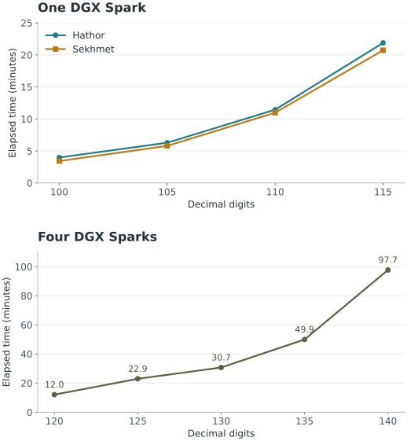

[Slug Factory](https://github.com/darrelllong/slug-factory) is an integer-factoring program I wrote in Rust. It provides a `factor` command and a library interface.

```text
$ factor 18446744073709551617
18446744073709551617: 274177 67280421310721
```

The program combines Pollard rho, a self-initializing multiple-polynomial quadratic sieve, and a general number field sieve. It removes small factors and recognizes prime powers before applying the more expensive methods. Its arithmetic comes from my [rump](https://github.com/darrelllong/rump) multiprecision library, with random generators and probability functions supplied by [entropy](https://github.com/darrelllong/entropy). The implementation is in Rust, and the code is available under the BSD 3-Clause license.

The number field sieve implements polynomial selection, relation collection, filtering, sparse linear algebra over the two-element field, and algebraic square roots. It supports distributed computation and saved runs that can be resumed. The matrix solver can use either block Lanczos or block Wiedemann.

## Why Factoring Is Interesting

Multiplying two large primes is easy; recovering them from their product can be much harder. RSA depends on this difference. The factoring algorithms are also interesting in their own right, combining probability, number theory, and linear algebra.

Pollard rho searches for collisions modulo an unknown prime factor. The quadratic sieve finds products that are squares by solving equations on prime-exponent parities. The number field sieve extends that method to arithmetic in a number field.

The implementation involves memory-efficient sieving, sparse matrices, and parallel work across cores and machines. Every reported factor is checked by exact division, and the complete factorization is checked against the input.

## Pollard Rho

Suppose $N$ is composite and $p$ is an unknown prime divisor. Choose a starting value and iterate a simple polynomial modulo $N$:

$$
x_{i+1}=x_i^2+c\pmod N.
$$

Reducing the sequence modulo $p$ gives a sequence with only $p$ possible values. It must eventually repeat. The initial path followed by a cycle resembles the Greek letter $\rho$, hence the name.

If two terms agree modulo $p$, then

$$
x_i\equiv x_j\pmod p
\quad\Longrightarrow\quad
p\mid(x_i-x_j).
$$

To detect a repeated value modulo $p$, compute

$$
d=\gcd(|x_i-x_j|,N).
$$

When $1<d<N$, we have found a factor. A gcd of one means that this comparison has found nothing; a gcd of $N$ means that the comparison has failed to separate the factors.

The expected cost follows from the birthday calculation. For $k$ independent draws from $p$ values, the probability of avoiding a collision is

$$
\prod_{j=0}^{k-1}\left(1-\frac{j}{p}\right)
\approx \exp\left(-\frac{k(k-1)}{2p}\right).
$$

A collision becomes likely when $k$ is of order $\sqrt p$. Modeling the polynomial as a random map gives rho the same expected cost. For two similarly sized prime factors, $p$ is about $\sqrt N$, giving about $N^{1/4}$ modular steps. Rho is useful for finding relatively small factors of large integers.

Slug Factory uses [Brent's version of rho](https://maths-people.anu.edu.au/~brent/pd/rpb051i.pdf). It compares a moving point against a saved point in stretches whose lengths double. It also batches the gcd computations. For a batch of differences, form

$$
D=\prod_j(x-y_j)\pmod N
$$

and take one $\gcd(D,N)$. Any factor dividing one of those differences divides the product. If the batch gives $N$, the program goes back through the individual differences to try to separate the factors. Batching reduces the number of gcd computations.

### The Rho Algorithm

Brent's cycle search uses the following procedure:

1. Choose the starting value $y$ and the polynomial constant $c$. Set the stretch length $r=1$.
2. Save $x=y$, then advance $y$ by $r$ polynomial evaluations.
3. Advance through the next $r$ values, accumulating $x-y$ into the batch product. At each batch boundary, compute its gcd with $N$.
4. A proper divisor ends the search. A gcd of $N$ triggers a replay of that batch with individual gcds; if the replay fails, start a new polynomial.
5. If every gcd was one, double $r$ and repeat from step 2.

The factoring driver gives rho a bounded amount of work before moving to a sieve. When any method finds a divisor $d$, the driver factors both $d$ and $N/d$ until the remaining factors pass its primality test.

## The Quadratic Sieve

The quadratic sieve uses the identity

$$
X^2-Y^2=(X-Y)(X+Y).
$$

Find $X$ and $Y$ for which

$$
X^2\equiv Y^2\pmod N,
$$

and then try $\gcd(X-Y,N)$ and $\gcd(X+Y,N)$. A nontrivial factor is obtained when $X$ agrees with $Y$ modulo one factor and with $-Y$ modulo another. If both gcds are trivial, try another congruence.

To construct these congruences, put $m=\lceil\sqrt N\rceil$ and use

$$
Q(x)=(m+x)^2-N.
$$

For small $x$, these values are much smaller than $N$, and every one gives a relation

$$
(m+x)^2\equiv Q(x)\pmod N.
$$

Choose a *factor base* of small primes. An integer is *smooth* over that base if all its prime factors belong to it. When a value of $Q$ is smooth, record its factorization:

$$
Q(x)=(-1)^{e_0}\prod_{j=1}^{t}p_j^{e_j}.
$$

A product of such values is a square exactly when its sign is positive and every prime exponent is even. We therefore keep the parity vector

$$
(e_0,e_1,\ldots,e_t)\pmod 2.
$$

Put these vectors into the columns of a matrix $M$ over $\mathbb F_2$, the field with elements zero and one. A nonzero vector $z$ satisfying $Mz=0$ selects relations whose product is a square. If the selected indices form a set $S$, then

$$
X=\prod_{i\in S}(m+x_i)\pmod N,
\qquad
Y=\prod_{j=1}^{t}p_j^{\frac12\sum_{i\in S}e_{ij}}\pmod N.
$$

The selected relations give $X^2\equiv Y^2\pmod N$, from which the gcds can yield a factor.

### Example

Take $N=1649$, so $m=41$. Two useful values are

| $x$ | $m+x$ | $Q(x)$ | Factorization |
|---:|---:|---:|---|
| 0 | 41 | 32 | $2^5$ |
| 2 | 43 | 200 | $2^3\cdot5^2$ |

Their exponent parities agree, so adding the two parity vectors gives zero. Their product is

$$
32\cdot200=2^8\cdot5^2=80^2.
$$

Meanwhile, $41\cdot43\equiv114\pmod{1649}$. Thus

$$
114^2\equiv80^2\pmod{1649},
$$

and

$$
\gcd(114-80,1649)=17,
\qquad
\gcd(114+80,1649)=97.
$$

Thus $1649=17\cdot97$.

### Sieving

Rather than trial-divide every $Q(x)$ by every base prime, solve $Q(x)\equiv0\pmod p$ once for each prime. Each root gives an arithmetic progression of positions divisible by $p$. Walk those progressions and add approximately $\log p$ to an array. Positions whose accumulated score accounts for most of $\log|Q(x)|$ are worth checking by exact division.

The factor base is chosen accordingly: for an odd prime not dividing $N$, the congruence has roots when $N$ is a quadratic residue modulo $p$.

As the interval grows, the values of a single polynomial grow too. Slug Factory changes polynomials to keep the values small, using the [multiple-polynomial quadratic sieve](https://www.ams.org/journals/mcom/1987-48-177/S0025-5718-1987-0866119-8/). Its polynomials have the form

$$
q(x)=Ax^2+2Bx+C,
\qquad
B^2-kN=AC,
$$

where $k$ is a small multiplier and $A$ is a product of factor-base primes. These polynomials satisfy

$$
(Ax+B)^2\equiv A q(x)\pmod N.
$$

The exponents contributed by $A$ are included in the relation. Choosing the signs of square roots modulo the primes dividing $A$, then combining them by the Chinese remainder theorem, produces a family of suitable values of $B$. Much of the setup can be reused across that family. This is the self-initializing part of the algorithm.

### The QS Algorithm

The implementation proceeds as follows:

1. Choose the multiplier $k$, factor-base bound, and sieve interval. Compute the square roots of $kN$ modulo each factor-base prime.
2. Construct a polynomial family by choosing $A$ and the corresponding values of $B$ and $C$.
3. For each polynomial, sieve an interval of $x$ values using the roots modulo the base primes and their powers.
4. Trial-divide the promising values to obtain exact relations. Retain partial relations with one allowed large prime; two partials containing the same large prime can be combined, making its exponent even.
5. Build the parity matrix, filter it, and solve for dependencies. Small matrices use elimination; larger ones use block Lanczos.
6. Reconstruct $X$ and $Y$ from each dependency and compute the gcds. Collect more relations or try another dependency when necessary.

Polynomial families can be sieved independently by different workers. The matrix stage combines the relations from all of them.

## The General Number Field Sieve

GNFS has six stages: polynomial selection, factor-base construction, relation collection, filtering, sparse linear algebra, and square roots. The objective is again a congruence $X^2\equiv Y^2\pmod N$. The relations now involve both integers and algebraic numbers.

### Polynomial Selection

Choose an irreducible polynomial $f$ of degree $d$ and a linear polynomial $g$ with a common root $m$ modulo $N$:

$$
f(m)\equiv g(m)\equiv0\pmod N.
$$

A basic construction writes $N$ in base $m$:

$$
N=c_dm^d+c_{d-1}m^{d-1}+\cdots+c_0.
$$

Then $f(x)=\sum_{i=0}^{d}c_ix^i$ and $g(x)=x-m$ have the required common root. The choice of $m$ determines the coefficients and therefore the sizes of the values to be sieved.

Slug Factory also uses [Kleinjung's polynomial selection](https://www.joppebos.com/montgomery/book_ch6.pdf). Here the linear polynomial is $g(x)=m_2x-m_1$, and the coefficients satisfy

$$
N=\sum_{i=0}^{d}c_i m_1^i m_2^{d-i}.
$$

Thus $m=m_1m_2^{-1}\pmod N$ is a common root. A nontrivial gcd of $m_2$ with $N$ already gives a factor.

Allowing $m_2\ne1$ gives more freedom to reduce $c_{d-1}$ and $c_{d-2}$. The search then improves the candidates by translation and by *rotation*:

$$
f_{\mathrm{new}}(x)=f(x)+(ux+v)g(x).
$$

Rotation preserves the common root because $g(m)\equiv0$. A root sieve searches these rotations for good divisibility by small primes. Murphy's $E$ score ranks the candidates by their estimated yield of usable relations, accounting for both value sizes and small-prime roots.

### Number Fields and Norms

First consider a monic $f$, so $c_d=1$. Let $\alpha$ be a root of $f$ and $K=\mathbb Q(\alpha)$. Evaluation at $m$ defines a ring homomorphism

$$
\phi:\mathbb Z[\alpha]\longrightarrow\mathbb Z/N\mathbb Z,
\qquad \phi(\alpha)=m.
$$

It is well defined because the relation $f(\alpha)=0$ maps to $f(m)\equiv0$. In particular,

$$
\phi(a-b\alpha)=a-bm\pmod N.
$$

The *norm* of $a-b\alpha$ is the product over the conjugate roots of $f$:

$$
\operatorname{Norm}_{K/\mathbb Q}(a-b\alpha)
=\prod_{j=1}^{d}(a-b\alpha_j)
=b^df(a/b).
$$

The sieve evaluates the two homogeneous forms

$$
F(a,b)=\sum_{i=0}^{d}c_i a^i b^{d-i},
\qquad G(a,b)=m_2a-m_1b.
$$

For a monic polynomial, $F$ is the algebraic norm. For a non-monic polynomial with leading coefficient $c$, it is $c\operatorname{Norm}(a-b\alpha)$. On the rational side, $G(a,b)\equiv m_2(a-bm)\pmod N$.

The algorithm seeks coprime pairs $(a,b)$ for which both $F(a,b)$ and $G(a,b)$ factor over small primes, with a limited number of larger primes allowed. A useful polynomial pair makes both forms small over the region being searched. For example,

$$
|F(a,b)|\leq\sum_{i=0}^{d}|c_i|\,|a|^i|b|^{d-i}.
$$

The coefficients need not have similar sizes. The sieve therefore uses a skewed region, adjusting the relative ranges of $a$ and $b$ to suit the selected polynomial.

### The Special-Prime Sieve

Choose a prime $q$ and a root $r$ of $f$ modulo $q$. Every pair satisfying $a\equiv br\pmod q$ has $q\mid F(a,b)$. These pairs form the lattice

$$
\Lambda_{q,r}=\{(a,b)\in\mathbb Z^2:a-br\equiv0\pmod q\},
$$

with basis $(q,0),(r,1)$ and determinant $q$. The known factor $q$ reduces the cofactor that must be smooth.

The program reduces this basis in the skewed geometry and writes its sieve points as

$$
(a,b)=i(u_0,v_0)+j(u_1,v_1).
$$

Now take another factor-base prime $p$ and root $t$. Its divisibility condition becomes

$$
(u_0-tv_0)i+(u_1-tv_1)j\equiv0\pmod p.
$$

For a fixed $j$, this gives the positions in the $i$ direction at which to add $\log p$ to the sieve score. The rational side uses the roots of $g$ in the same way. Prime powers add further contributions.

Workers process separate special-prime ranges. Within each lattice, they sieve blocks, select positions with sufficient scores on both sides, and divide the corresponding values exactly. The accepted records contain $(a,b)$ and the complete factorizations of both forms. Large primes remain attached to the relations and become additional matrix entries.

### The Relation Matrix

On the rational side, record the exponents in

$$
G(a_i,b_i)=(-1)^{\epsilon_i}\prod_p p^{e_{p,i}}.
$$

On the algebraic side, a prime can split into distinct prime ideals. For a prime $p$ not dividing the discriminant of a monic $f$, a root $r$ identifies the degree-one ideal

$$
\mathfrak p_{p,r}=(p,\alpha-r).
$$

The condition $a_i\equiv b_i r\pmod p$ says that this ideal divides $(a_i-b_i\alpha)$. Its exponent must be tracked separately from the exponents at other roots of the same prime. Combining them into a single exponent of $p$ would lose information needed to form an algebraic square. The implementation records entries by $(p,r)$, including the appropriate entries for repeated and projective roots.

A dependency must make all rational exponents even and all algebraic factor entries even. The matrix also includes sign information and quadratic characters. For an auxiliary odd prime $\ell$ and a simple root $s$ of $f$ modulo $\ell$, the character bit is

$$
\chi_{\ell,s}(a,b)
=\frac{1-\left(\frac{a-bs}{\ell}\right)}{2},
\qquad \ell\nmid a-bs,
$$

where the inner fraction is the Legendre symbol. It is zero for a nonzero square and one for a nonsquare. Characters multiply, so their bits add modulo two. Even ideal exponents alone do not settle the contribution of units; the character rows supply additional square conditions.

Put each relation's bits in a column of $M$. A vector $z$ satisfying

$$
Mz=0\quad\text{over }\mathbb F_2
$$

selects relations in which every recorded parity cancels. A row of ones also requires an even number of selected relations, which is used in the leading-coefficient calculation below.

### Filtering and Sparse Linear Algebra

Filtering is structured elimination before the main matrix solve. With relations as columns, a row containing only one nonzero forces that relation's coefficient to be zero. Remove it, then repeat because the removal may create further singletons. A row with two nonzeros forces the two relation coefficients to agree, so their columns can be combined by XOR. More general sparse eliminations reduce the matrix while controlling how many nonzeros they introduce. Each combination retains its original relation indices so that a final dependency can be expanded.

The remaining matrix is large and sparse. Ordinary elimination can fill it with nonzeros. Slug Factory instead uses block Lanczos or block Wiedemann for the large systems. Both repeatedly multiply the sparse matrix by blocks of vectors. Sixty-four binary vectors fit into the bits of one machine word, allowing a word XOR to update all 64 together.

**Block Lanczos**, in [Montgomery's formulation](https://link.springer.com/chapter/10.1007/3-540-49264-X_9), works with the symmetric operator

$$
A=M^{\mathsf T}M,
\qquad AV=M^{\mathsf T}(MV).
$$

The program never forms $A$. It applies $M$, then its transpose, using the sparse representation. Starting with a random block, the recurrence builds blocks from the Krylov spaces generated by $V,AV,A^2V,\ldots$. At each step it forms the small matrix $T_i=V_i^{\mathsf T}AV_i$ and selects a subspace on which $T_i$ is invertible. The retained blocks are orthogonal under the bilinear form defined by $A$:

$$
W_i^{\mathsf T}AW_j=0\qquad(i\ne j).
$$

This lets the recurrence remove components already represented by earlier blocks. The final blocks provide candidate null vectors; a small elimination finds combinations that satisfy $Mz=0$.

**Block Wiedemann** separates the calculation into three stages. Let $B$ be $M$ padded with zero rows or columns to make it square. Choose random blocks $U$ and $V$, and set $Y=BV$.

1. Generate the small matrices $S_j=U^{\mathsf T}B^jY$. Independent slices of the block can be generated on different hosts.
2. Find matrix coefficients $C_0,\ldots,C_t$ satisfying a recurrence

   $$
   \sum_{i=0}^{t}S_{k-i}C_i=0.
   $$

   This uses a block generalization of the Berlekamp–Massey algorithm.
3. Replay the matrix products to reconstruct candidate vectors from

   $$
   W=\sum_{i=0}^{t}B^{t-i}VC_i.
   $$

   Horner evaluation computes this sum without storing all the powers of $B$. The independent slices can again run on different hosts, after which their contributions are added.

The returned vectors are checked against the original relation matrix. [Coppersmith's block Wiedemann algorithm](https://research.ibm.com/publications/solving-homogeneous-linear-equations-over-gf2-via-block-wiedemann-algorithm) provides the basis for this distributed solver.

### Algebraic Square Roots

For the monic case with $g=x-m$, a successful dependency gives a set $S$ such that

$$
\prod_{i\in S}(a_i-b_i m)=Y^2,
\qquad
\prod_{i\in S}(a_i-b_i\alpha)=\gamma^2.
$$

The rational root is an integer square root. For the algebraic product, the program multiplies polynomials in a balanced product tree, reducing modulo $f$ after each multiplication.

The algebraic root $\gamma$ is integral but need not lie in $\mathbb Z[\alpha]$. The inclusion $f'(\alpha)\mathcal O_K\subseteq\mathbb Z[\alpha]$ gives a root in that ring after multiplying by $f'(\alpha)$. Thus the calculation uses

$$
\delta=f'(\alpha)^2\prod_{i\in S}(a_i-b_i\alpha),
\qquad \beta^2=\delta.
$$

Choose an odd prime $\ell$ for which $f$ is irreducible modulo $\ell$ and the image of $\delta$ is nonzero. Then

$$
\mathbb F_\ell[x]/(f)\cong\mathbb F_{\ell^d}
$$

is a finite field. Compute a square root there using exponentiation when $\ell^d\equiv3\pmod4$, or Tonelli–Shanks otherwise. Lift that root from modulus $\ell^k$ to modulus $\ell^{2k}$ using Newton's iteration:

$$
\beta_{\mathrm{new}}
=\beta-(\beta^2-\delta)(2\beta)^{-1}
\pmod{(f,\ell^{2k})}.
$$

Each step doubles the available precision. The coefficients are reconstructed as signed integers, and the result is accepted when $\beta^2=\delta$ exactly modulo $f$. This is the direct lifting method described by [Emmanuel Thomé](https://doi.org/10.1007/978-3-642-31662-3_15).

Finally, evaluation at $m$ gives

$$
X=\beta(m),\qquad Z=f'(m)Y,
\qquad X^2\equiv Z^2\pmod N.
$$

Compute $\gcd(X-Z,N)$ and $\gcd(X+Z,N)$ to obtain factors.

### Leading Coefficients

For a non-monic $f$ with leading coefficient $c$, the program sets $\omega=c\alpha$. This is an algebraic integer with monic polynomial

$$
\widehat f(x)=c^{d-1}f(x/c).
$$

Each algebraic factor becomes $ca-b\omega=c(a-b\alpha)$. If $h=|S|$ is even, then $c^h$ is a square, and the algebraic square-root calculation is

$$
\beta^2=\widehat f'(\omega)^2
\prod_{i\in S}(ca_i-b_i\omega).
$$

Let $v^2=\prod_{i\in S}G(a_i,b_i)$ on the rational side. Since $G(a,b)\equiv m_2(a-bm)\pmod N$, the resulting congruence can be written

$$
X=m_2^{h/2}\beta(cm),
\qquad
Z=\widehat f'(cm)c^{h/2}v,
$$

with $X^2\equiv Z^2\pmod N$. This accounts for both leading coefficients and explains the even-count row in the matrix. The number field construction is developed in [Buhler, Lenstra, and Pomerance's account of GNFS](https://pub.math.leidenuniv.nl/~hwl/PUBLICATIONS/1993e/art.pdf).

## Running Time

The usual running-time estimates for the two sieves use the notation

$$
L_N[\alpha,c]
=\exp\!\left((c+o(1))\,(\log N)^\alpha
\,(\log\log N)^{1-\alpha}\right).
$$

The quadratic sieve has estimated complexity $L_N[1/2,1]$. For the general number field sieve it is $L_N[1/3,(64/9)^{1/3}]$. The smaller exponent makes the number field sieve faster for sufficiently large general integers.

## Timings

All of these runs used NVIDIA DGX Sparks, with 20 CPU workers per machine.



*Elapsed time for complete factorizations. Top: Hathor and Sekhmet, means of three runs completed November 26. Bottom: four Sparks working together, runs completed November 23. Both use block Lanczos. [Timing data](/downloads/slug-factory-timings.csv).*

The single-machine ladder runs from 100 to 115 digits. At 100 digits, the complete calculation took about three and a half minutes on Sekhmet and four minutes on Hathor. At 115 digits, it took about twenty-one and twenty-two minutes. Sekhmet used its local hard disk; Hathor accessed that disk over NFS.

The four-machine ladder reaches 140 digits. The 120-digit input took twelve minutes, and the 140-digit input took about an hour and thirty-eight minutes. Those timings include polynomial selection, sieving, the matrix calculation, and square roots.

## Source Code

[Slug Factory](https://github.com/darrelllong/slug-factory) contains the program, library, build instructions, and a guide to saved and distributed runs. Its modules cite the papers behind the algorithms. Carl Pomerance's [*A Tale of Two Sieves*](https://math.dartmouth.edu/~carlp/PDF/paper109.pdf) gives an account of the development of the sieve methods.
